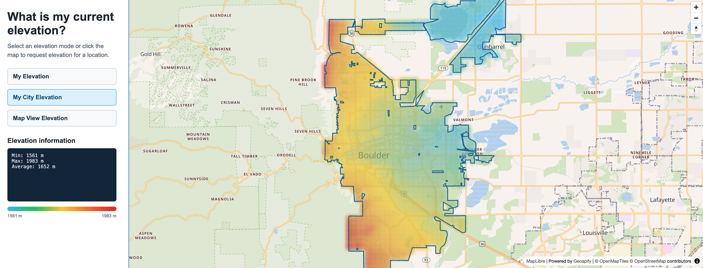
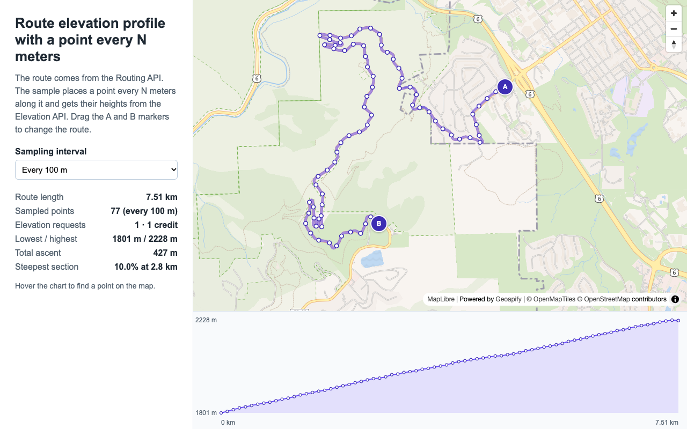
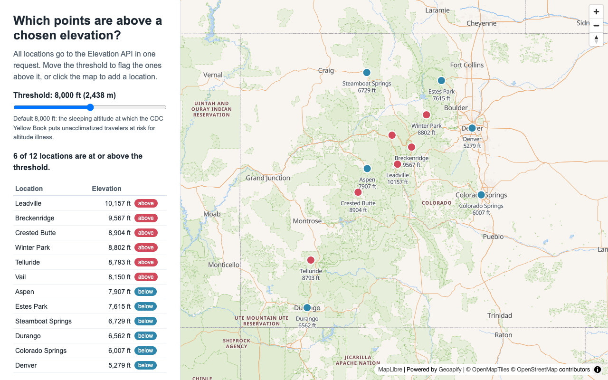

# Geoapify Elevation API Code Examples

Use Geoapify Elevation API examples to get terrain elevation for coordinates, visualize elevation on maps, and combine elevation lookup with location, boundary, and map workflows.

## Overview

This folder contains browser-based JavaScript examples for building elevation lookup tools with Geoapify Elevation API and MapLibre GL JS. Each example includes source code, a screenshot, and a focused README with setup notes and code samples.

## API Resources

## Live Demo

Each CodePen demo is linked from the `Live Demo` column in the code examples table.

## Code Examples

| Screenshot | Example | Description | Source Code | Live Demo |
|------------|---------|-------------|-------------|-----------|
|  | What Is My Current Elevation? Create an Elevation Finder with Geoapify and MapLibre | Build an interactive elevation finder for the user's location, a selected city, or the current map view. | [Open example](https://github.com/geoapify/geoapify-quickstart-examples/tree/main/elevation-api/what-is-my-current-elevation-tool/) | [CodePen](https://codepen.io/geoapify/pen/EaZgMeJ) |
|  | Route Elevation Profile with a Point Every N Meters | Sample a Routing API route every N meters and get the heights from the Elevation API for an evenly spaced elevation profile. | [Open example](https://github.com/geoapify/geoapify-quickstart-examples/tree/main/elevation-api/route-elevation-profile-fixed-interval/) | [CodePen](https://codepen.io/editor/geoapify/pen/01a1e895-5769-7c11-ae16-62a6eb18f0a4) |
|  | Which Points Are Above a Chosen Elevation? | Get the elevation of many locations in one request and flag the ones above a threshold. | [Open example](https://github.com/geoapify/geoapify-quickstart-examples/tree/main/elevation-api/locations-above-elevation-threshold/) | [CodePen](https://codepen.io/editor/geoapify/pen/01a1e895-877e-7333-bb37-d4aa0faab13a) |

## Geoapify API Key

These examples include demo Geoapify API keys for quick testing. For your own project, create a free API key at [myprojects.geoapify.com](https://myprojects.geoapify.com/) and replace the example key in the relevant `src/script.js` file.

## APIs and Libraries

| Name | Description | Documentation | Used In This Example |
|------|-------------|---------------|----------------------|
| Geoapify Elevation API | Returns elevation values for one or more latitude/longitude coordinates. | [Elevation API docs](https://apidocs.geoapify.com/docs/elevation/) | [What Is My Current Elevation?](./what-is-my-current-elevation-tool/), [Route Elevation Profile](./route-elevation-profile-fixed-interval/), [Points Above an Elevation](./locations-above-elevation-threshold/) |
| Geoapify IP Geolocation API | Provides approximate user location from IP address for fallback positioning. | [IP Geolocation docs](https://apidocs.geoapify.com/docs/ip-geolocation/) | [What Is My Current Elevation?](./what-is-my-current-elevation-tool/) |
| Geoapify Routing API | Returns route geometry that can be sampled for elevation profiles. | [Routing API docs](https://apidocs.geoapify.com/docs/routing/) | [Route Elevation Profile](./route-elevation-profile-fixed-interval/) |
| Geoapify Boundaries API | Returns administrative boundaries used for city elevation workflows. | [Boundaries docs](https://apidocs.geoapify.com/docs/boundaries/) | [What Is My Current Elevation?](./what-is-my-current-elevation-tool/) |
| Geoapify Geometry Operation API | Creates grids, bounding boxes, and point-in-polygon results for elevation sampling. | [Geometry Operation docs](https://apidocs.geoapify.com/docs/geometry-operations/) | [What Is My Current Elevation?](./what-is-my-current-elevation-tool/) |
| Geoapify Map Tiles API | Provides map styles and tiles for MapLibre-based examples. | [Map Tiles docs](https://apidocs.geoapify.com/docs/maps/map-tiles/) | [What Is My Current Elevation?](./what-is-my-current-elevation-tool/), [Route Elevation Profile](./route-elevation-profile-fixed-interval/), [Points Above an Elevation](./locations-above-elevation-threshold/) |
| MapLibre GL JS | Renders interactive vector maps in browser examples. | [MapLibre GL JS docs](https://maplibre.org/maplibre-gl-js/docs/) | [What Is My Current Elevation?](./what-is-my-current-elevation-tool/), [Route Elevation Profile](./route-elevation-profile-fixed-interval/), [Points Above an Elevation](./locations-above-elevation-threshold/) |

## Useful Links

- Geoapify API documentation: [https://apidocs.geoapify.com/](https://apidocs.geoapify.com/)
- Geoapify projects and API keys: [https://myprojects.geoapify.com/](https://myprojects.geoapify.com/)
- Geoapify CodePen examples: [https://codepen.io/geoapify](https://codepen.io/geoapify)
