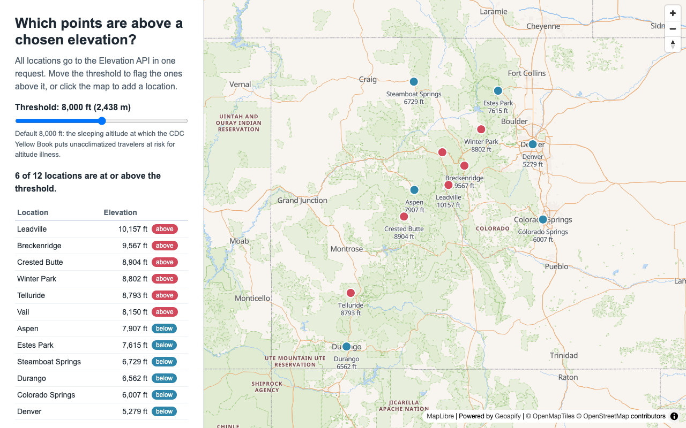

# Which Points Are Above a Chosen Elevation?

Check which locations lie above a given elevation: get the height of many coordinates in one Geoapify Elevation API request and flag the ones at or above a threshold on a MapLibre map.

## Overview

This example sends 12 Colorado towns, from Denver to Leadville, to the Elevation API in one request, in feet and as GeoJSON. A slider sets the threshold from 4,000 to 12,000 ft. The default is 8,000 ft, the sleeping altitude at which the [CDC Yellow Book](https://www.cdc.gov/yellow-book/hcp/environmental-hazards-risks/high-altitude-travel-and-altitude-illness.html) puts unacclimatized travelers at risk for altitude illness; 6 of the 12 towns are at or above it. Moving the slider recolors the map and the sorted table without a new request. Click the map to add a location: the example sends all locations again, which still costs 1 credit for up to 100 locations.

## Live Demo

[](https://codepen.io/editor/geoapify/pen/01a1e895-877e-7333-bb37-d4aa0faab13a)

## Screenshot



## Quick Start

Open [`src/index.html`](./src/index.html) in your browser.

No build step is required.

## Geoapify API Key

This example includes a demo Geoapify API key. For your own project, create a free API key at [myprojects.geoapify.com](https://myprojects.geoapify.com/) and replace the `apiKey` value in [`src/script.js`](./src/script.js).

## Project Structure

| File | Purpose |
|------|---------|
| `src/index.html` | Page layout, threshold slider and results table |
| `src/script.js` | Map setup, the Elevation API request, map layers and the table |
| `src/style.css` | Panel, table and badge styles |

## Key Code Samples

### Get the Elevation of Many Locations in One Request

Send all locations as `[lon, lat]` arrays in one POST request. With `format: "geojson"` the API returns one Point feature per location, in the input order.

```js
const locations = [
  { name: "Denver", location: [-104.9849, 39.7392] },
  { name: "Leadville", location: [-106.2925, 39.2508] },
  // ...
];

const response = await fetch(`https://api.geoapify.com/v1/geodata/elevation?apiKey=${apiKey}`, {
  method: "POST",
  headers: { "Content-Type": "application/json" },
  body: JSON.stringify({
    units: "imperial",
    format: "geojson",
    locations: locations.map((item) => item.location),
  }),
});
const body = await response.json();

const features = body.features
  .map((feature, i) => ({
    ...feature,
    properties: { ...feature.properties, name: locations[i].name },
  }))
  .filter((feature) => feature.properties.elevation !== null);
```

How it works:

- One request takes up to 1,000 locations and costs `max(1, ceil(locations / 100))` credits.
- `units: "imperial"` returns the elevation in feet.
- Features carry only `elevation` and `units`, so the names are added back by index.
- Locations without elevation data come back with `elevation: null`. They are removed before the features go to the map.

### Color Points by the Threshold

A MapLibre `case` expression compares each feature's elevation with the threshold. When the slider moves, only the paint property changes; no new request is sent.

```js
function thresholdColor(threshold) {
  return ["case", [">=", ["get", "elevation"], threshold], "#d1495b", "#2e86ab"];
}

map.addSource("locations", {
  type: "geojson",
  data: { type: "FeatureCollection", features },
});

map.addLayer({
  id: "locations",
  type: "circle",
  source: "locations",
  paint: {
    "circle-radius": 8,
    "circle-stroke-width": 2,
    "circle-stroke-color": "#ffffff",
    "circle-color": thresholdColor(8000),
  },
});

thresholdInput.addEventListener("input", () => {
  map.setPaintProperty("locations", "circle-color", thresholdColor(Number(thresholdInput.value)));
});
```

How it works:

- Points at or above the threshold are red, the others blue.
- `setPaintProperty` recolors the layer in place, so the map doesn't reload the data.

## APIs and Libraries

| Name | Description | Documentation | Used In This Example |
|------|-------------|---------------|----------------------|
| [Geoapify Elevation API](https://www.geoapify.com/elevation-api/) | Returns the elevation of up to 1,000 coordinates per request, in meters or feet, as JSON or GeoJSON. | [Elevation API docs](https://apidocs.geoapify.com/docs/elevation/) | Heights of all locations |
| [Geoapify Map Tiles API](https://www.geoapify.com/map-tiles/) | Provides the OSM Bright map style for MapLibre. | [Map Tiles docs](https://apidocs.geoapify.com/docs/maps/map-tiles/) | Base map |
| [MapLibre GL JS](https://maplibre.org/) | Renders the interactive vector map. | [MapLibre GL JS docs](https://maplibre.org/maplibre-gl-js/docs/) | Circle and label layers, threshold expression |

## Related Code Samples

| Code Sample | Why It Is Related |
|-------------|-------------------|
| [Route Elevation Profile with a Point Every N Meters](https://github.com/geoapify/geoapify-quickstart-examples/tree/main/elevation-api/route-elevation-profile-fixed-interval) | Sends many points to the Elevation API along a route |
| [What Is My Current Elevation?](https://github.com/geoapify/geoapify-quickstart-examples/tree/main/elevation-api/what-is-my-current-elevation-tool) | Elevation for a location, a city or the map view |

## Useful Links

- How-to guide: [How to Check Which Locations Lie Above a Given Elevation](https://apidocs.geoapify.com/how-to/location-analysis/locations-above-elevation/)
- Geoapify API documentation: [https://apidocs.geoapify.com/](https://apidocs.geoapify.com/)
- Geoapify CodePen examples: [https://codepen.io/geoapify](https://codepen.io/geoapify)

## License

MIT
