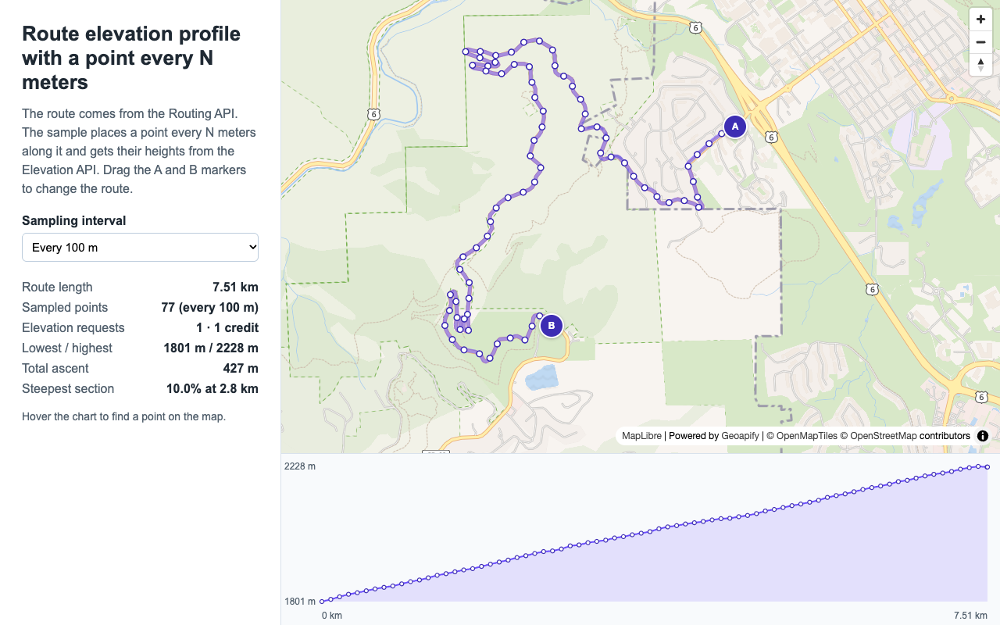

# Route Elevation Profile with a Point Every N Meters

Build a route elevation profile with an even sampling interval: get a route from the Geoapify Routing API, place a point every N meters along it, and get the height of each point from the Geoapify Elevation API.

## Overview

The Routing API can return elevation for a route itself, but only at the route's geometry points, and those are unevenly spaced. For a chart with an even step, or for a fair comparison of two routes, this example walks the route line and adds a point every N meters (200, 100, 50, 25 or 10 m), keeping the first and last point. It then sends the points to the Elevation API, at most 1,000 per request, and draws the profile with total ascent and the steepest section.

The route goes from 19th Street in Golden, Colorado, up Lookout Mountain Road to the Buffalo Bill Memorial Museum. Drag the A and B markers to plan another route, and hover the chart to see each point on the map.

The **Elevation source** switch compares two ways to get the profile:

- **Elevation API: a point every N meters** (default). An even step, set by the interval menu. Use it when the spacing matters: a chart with equal steps, the grade of each section, or two routes compared in the same way.
- **Routing API: route points** (`details=elevation`). The Routing API returns a height for each point of the route geometry, so no Elevation API request is needed. The points follow the geometry: on this route there are 589 of them, from 1.3 m to 114 m apart (median 9.7 m). If spacing doesn't matter and you only need a chart, this is enough.

The sample requests the route with `details=elevation` once, so switching the source doesn't send a new Routing request.

| Source | Points | Spacing | Elevation API requests |
|--------|--------|---------|------------------------|
| Routing API, `details=elevation` | 589 | 1.3–114 m, median 9.7 m | none |
| Elevation API, every 100 m | 77 | 100 m | 1 (1 credit) |
| Elevation API, every 25 m | 302 | 25 m | 1 (4 credits) |
| Elevation API, every 10 m | 752 | 10 m | 1 (8 credits) |

## Live Demo

[](https://codepen.io/editor/geoapify/pen/01a1e895-5769-7c11-ae16-62a6eb18f0a4)

## Screenshot



## Quick Start

Open [`src/index.html`](./src/index.html) in your browser.

No build step is required.

## Geoapify API Key

This example includes a demo Geoapify API key. For your own project, create a free API key at [myprojects.geoapify.com](https://myprojects.geoapify.com/) and replace the `apiKey` value in [`src/script.js`](./src/script.js).

## Project Structure

| File | Purpose |
|------|---------|
| `src/index.html` | Page layout, elevation source switch, interval selector, stats and chart containers |
| `src/script.js` | Map setup, Routing and Elevation API requests, sampling, stats and chart |
| `src/style.css` | Panel, markers and chart styles |

## Key Code Samples

### Get the Route Geometry

Request a route with `format=json`. The geometry comes back as one array of `{lon, lat}` objects per route leg, so flatten it into one line of `[lon, lat]` pairs. `details=elevation` is only needed for the Routing API source below.

```js
const url = `https://api.geoapify.com/v1/routing?waypoints=${startLat},${startLon}|${endLat},${endLon}&mode=bicycle&details=elevation&format=json&apiKey=${apiKey}`;

const response = await fetch(url);
const body = await response.json();

const routeCoordinates = body.results[0].geometry
  .flat()
  .map(({ lon, lat }) => [lon, lat]);
```

How it works:

- `waypoints` takes `lat,lon` pairs separated by `|`.
- `flat()` joins the legs; the result is the full route line in `[lon, lat]` order.

### Use the Route's Own Heights (`details=elevation`)

With `details=elevation`, every route leg has an `elevation_range` array: one `[distance, height]` pair in meters for each geometry point of that leg. Match the pairs to the leg's geometry by index to get a profile without an Elevation API request.

```js
function getRouteElevation(route) {
  let offset = 0;
  return route.legs.flatMap((leg, legIndex) => {
    const points = leg.elevation_range.map(([distance, height], i) => {
      const { lon, lat } = route.geometry[legIndex][i];
      return { distance: offset + distance, location: [lon, lat], elevation: height };
    });
    offset += leg.distance;
    return points;
  });
}

const routeProfile = getRouteElevation(body.results[0]);
```

How it works:

- Distances in `elevation_range` start at 0 on every leg, so the length of the previous legs is added as `offset`.
- The points are where the route geometry has them: close together on curves, far apart on straight sections. The sample shows the smallest, largest and median gap.
- The profile has the same shape as the one below and works with the same chart, but its step is uneven.

### Place a Point Every N Meters

Walk the route line, measure each segment with the haversine formula, and add an interpolated point each time the traveled distance reaches the next step.

```js
function haversine([lon1, lat1], [lon2, lat2]) {
  const earthRadius = 6371008.8;
  const rad = (degrees) => (degrees * Math.PI) / 180;
  const dLat = rad(lat2 - lat1);
  const dLon = rad(lon2 - lon1);
  const a =
    Math.sin(dLat / 2) ** 2 + Math.cos(rad(lat1)) * Math.cos(rad(lat2)) * Math.sin(dLon / 2) ** 2;
  return 2 * earthRadius * Math.asin(Math.sqrt(a));
}

function samplePoints(coords, interval) {
  const points = [{ location: coords[0], distance: 0 }];
  let traveled = 0;
  let next = interval;

  for (let i = 1; i < coords.length; i++) {
    const a = coords[i - 1];
    const b = coords[i];
    const segment = haversine(a, b);

    while (segment > 0 && traveled + segment >= next) {
      const t = (next - traveled) / segment;
      points.push({
        location: [a[0] + (b[0] - a[0]) * t, a[1] + (b[1] - a[1]) * t],
        distance: next,
      });
      next += interval;
    }
    traveled += segment;
  }

  const last = coords[coords.length - 1];
  if (traveled - points[points.length - 1].distance > 1) {
    points.push({ location: last, distance: traveled });
  }
  return points;
}
```

How it works:

- Each point keeps its `distance` from the start, which becomes the x axis of the chart.
- A long segment can hold several points, so the `while` loop adds all of them.
- The route end is added as the last point, so the profile always reaches B.

### Get the Elevation of the Points

Send the points to the Elevation API in chunks of up to 1,000 locations. Results come back in the input order, so each height is matched to its point by index.

```js
async function getProfile(points) {
  const url = `https://api.geoapify.com/v1/geodata/elevation?apiKey=${apiKey}`;
  const chunks = [];
  for (let start = 0; start < points.length; start += 1000) {
    chunks.push(points.slice(start, start + 1000));
  }

  const answers = await Promise.all(
    chunks.map(async (chunk) => {
      const response = await fetch(url, {
        method: "POST",
        headers: { "Content-Type": "application/json" },
        body: JSON.stringify({ locations: chunk.map((point) => point.location) }),
      });
      return { body: await response.json(), chunk };
    })
  );

  return answers
    .flatMap(({ body, chunk }) =>
      body.results.map((result, i) => ({
        distance: chunk[i].distance,
        location: chunk[i].location,
        elevation: result.elevation,
      }))
    )
    .filter((point) => point.elevation !== null);
}
```

How it works:

- `locations` takes `[lon, lat]` arrays; more than 1,000 in one request returns HTTP 400.
- A request costs `max(1, ceil(locations / 100))` credits, so 77 points cost 1 credit and 752 points cost 8.
- Points without elevation data come back with `elevation: null` and are left out of the profile.

## APIs and Libraries

| Name | Description | Documentation | Used In This Example |
|------|-------------|---------------|----------------------|
| [Geoapify Routing API](https://www.geoapify.com/routing-api/) | Returns the bike route geometry between A and B, and its heights with `details=elevation`. | [Routing API docs](https://apidocs.geoapify.com/docs/routing/) | Route line to sample, route-point elevation source |
| [Geoapify Elevation API](https://www.geoapify.com/elevation-api/) | Returns the elevation of up to 1,000 coordinates per request. | [Elevation API docs](https://apidocs.geoapify.com/docs/elevation/) | Heights of the sampled points |
| [Geoapify Map Tiles API](https://www.geoapify.com/map-tiles/) | Provides the OSM Bright map style for MapLibre. | [Map Tiles docs](https://apidocs.geoapify.com/docs/maps/map-tiles/) | Base map |
| [MapLibre GL JS](https://maplibre.org/) | Renders the interactive vector map. | [MapLibre GL JS docs](https://maplibre.org/maplibre-gl-js/docs/) | Map, route line, sampled points and markers |

## Related Code Samples

| Code Sample | Why It Is Related |
|-------------|-------------------|
| [Which Points Are Above a Chosen Elevation?](https://github.com/geoapify/geoapify-quickstart-examples/tree/main/elevation-api/locations-above-elevation-threshold) | Gets the elevation of many locations in one request |
| [What Is My Current Elevation?](https://github.com/geoapify/geoapify-quickstart-examples/tree/main/elevation-api/what-is-my-current-elevation-tool) | Elevation for a location, a city or the map view |

## Useful Links

- How-to guide: [How to Sample Elevation Along a Route at a Fixed Interval](https://apidocs.geoapify.com/how-to/routing/route-elevation-fixed-interval/)
- Geoapify API documentation: [https://apidocs.geoapify.com/](https://apidocs.geoapify.com/)
- Geoapify CodePen examples: [https://codepen.io/geoapify](https://codepen.io/geoapify)

## License

MIT
