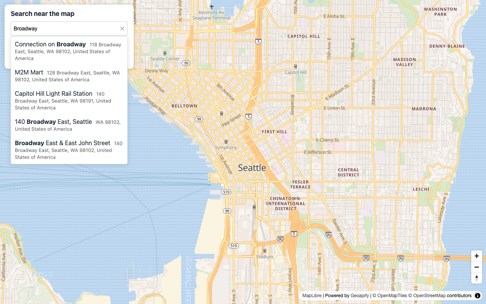

# Map-Aware Address Autocomplete: Suggestions Near the Map View First, or Only in This Map Area

Make address autocomplete follow the map. In this [MapLibre GL](https://maplibre.org/) example, the [Geoapify Address Autocomplete API](https://apidocs.geoapify.com/docs/geocoding/address-autocomplete/) gets a **proximity bias** at the map center, so addresses near what the user is looking at come first. An "Only in this map area" switch adds a **rectangle filter** from the visible map, so only addresses inside it are suggested.

## Overview

- **Problem:** a search box next to a map suggests addresses from anywhere, while the user is looking at one area.
- **Solution:** update the autocomplete's `bias` (and optionally its `filter`) from the map every time the map stops moving.
- **Stack:** HTML, CSS, JavaScript, [MapLibre GL JS](https://maplibre.org/maplibre-gl-js/docs/), [@geoapify/geocoder-autocomplete](https://www.npmjs.com/package/@geoapify/geocoder-autocomplete), no build step.
- **APIs:** Geoapify Address Autocomplete API (through the library) and Geoapify Map Tiles.

**Bias or filter?**

| | Bias (`bias=proximity:lon,lat`) | Filter (`filter=rect:lon1,lat1,lon2,lat2`) |
|---|---|---|
| What it does | changes the order: nearby results first | removes results outside the area |
| Results from elsewhere | can still appear | never appear |
| Use it when | the user *probably* means a nearby address | the address *must* be in this area (a delivery zone, a city map) |

## Live Demo

[](https://codepen.io/editor/geoapify/pen/01a21239-82a1-76b0-8270-03856b09692b)

## Screenshot



## Quick Start

Open [`src/index.html`](./src/index.html) in your browser. No build step is required.

Type a full address such as `500 Pike St`: Seattle results come first. Turn on **Only in this map area** and type `Broadway`: only Broadway East on the visible map is suggested. Pan or zoom the map, and the next search follows it.

## Geoapify API Key

This example includes a demo Geoapify API key that can be blocked or restricted at any time. For your own project, create a free API key at [myprojects.geoapify.com](https://myprojects.geoapify.com/) and replace `yourAPIKey` in [`src/script.js`](./src/script.js).

## Project Structure

| File | Purpose |
|------|---------|
| `src/index.html` | Map container and the search panel; loads MapLibre GL and the Geocoder Autocomplete library |
| `src/script.js` | Map setup, autocomplete, bias and filter from the map, marker on selection |
| `src/style.css` | Full-screen map and the floating panel |

## Code Samples

### Update the bias and the filter from the map

After every pan or zoom (`moveend`), the code replaces the bias with the new map center. When the switch is on, it also replaces the filter with the visible map bounds.

```js
function updateSearchArea() {
  const center = map.getCenter();
  addressField.clearBias();
  addressField.addBiasByProximity({ lon: center.lng, lat: center.lat });

  addressField.clearFilters();
  if (areaOnlySwitch.checked) {
    const bounds = map.getBounds();
    addressField.addFilterByRect({
      lon1: bounds.getWest(),
      lat1: bounds.getSouth(),
      lon2: bounds.getEast(),
      lat2: bounds.getNorth()
    });
  }
}

map.on("load", updateSearchArea);
map.on("moveend", updateSearchArea);
areaOnlySwitch.addEventListener("change", updateSearchArea);
```

How it works:

- `addBiasByProximity` and `addFilterByRect` replace the previous value of the same kind, so each pan simply moves the bias point and the rectangle.
- `clearFilters()` is what removes the rectangle when the switch is turned off; `clearBias()` makes sure the map center is the only bias.
- The library sends them as `bias=proximity:lon,lat` and `filter=rect:lon1,lat1,lon2,lat2` with the next request; the request after a pan already uses the new area.
- `moveend` fires once after a pan or zoom ends, not for every frame.

### Show the selected address on the map

```js
addressField.on("select", (place) => {
  if (marker) marker.remove();
  if (!place) return; // the field was cleared

  const [lon, lat] = place.geometry.coordinates;
  marker = new maplibregl.Marker({ color: "#2563eb" }).setLngLat([lon, lat]).addTo(map);
  map.flyTo({ center: [lon, lat], zoom: Math.max(map.getZoom(), 16) });
});
```

How it works:

- `place` is a GeoJSON feature; its coordinates are `[lon, lat]`, the order MapLibre expects.
- After `flyTo` the map moves, so `moveend` updates the bias (and the filter) to the new view.

## Troubleshooting

| Problem | Likely Cause | What to Do |
|---------|--------------|------------|
| No suggestions with the switch on | Nothing matches inside the visible map | Zoom out or pan, or turn the switch off. |
| The suggestion list opens in the wrong place | The container has no `position: relative` | Keep the `.autocomplete-container` style from `src/style.css`. |
| Map or suggestions don't load / API responds `401` or `403` | The API key is invalid, restricted or over its limits | Get your own free key at [myprojects.geoapify.com](https://myprojects.geoapify.com/) and update `yourAPIKey`. |
| Output differs from expected | Local edits changed the behaviour | Compare your files with the [CodePen demo](https://codepen.io/editor/geoapify/pen/01a21239-82a1-76b0-8270-03856b09692b). |

## APIs and Libraries

| Name | Description | Documentation | Used In This Example |
|------|-------------|---------------|----------------------|
| Geoapify Address Autocomplete API | Address suggestions as the user types, with bias and filter | [Docs](https://apidocs.geoapify.com/docs/geocoding/address-autocomplete/) | Search field, through the library |
| Geoapify Map Tiles | Vector map style `osm-bright` | [Docs](https://apidocs.geoapify.com/docs/maps/map-tiles/) | The map |
| @geoapify/geocoder-autocomplete | Autocomplete input with bias and filter methods | [npm](https://www.npmjs.com/package/@geoapify/geocoder-autocomplete) | `addBiasByProximity`, `addFilterByRect` |
| MapLibre GL JS | Vector map rendering | [Docs](https://maplibre.org/maplibre-gl-js/docs/) | Map, bounds, marker |

## Related Examples

| Example | Description | Link |
|---------|-------------|------|
| MapLibre Integration | Autocomplete plus reverse geocoding on map click | [Open](../maplibre-gl-integration-vector-maps-and-reverse-geocoding-on-click) |
| Filters and Bias | Country filter and a fixed proximity bias, no map | [Open](../filters-bias-demonstrates-filter-and-bias-customization) |
| Same Name, Different Places | Geocoding API filter and bias for "Springfield" on a map | [Open](../../geocoding-api/maplibre-same-name-different-places-filter-and-bias) |

## Useful Links

- Geoapify API docs: [https://apidocs.geoapify.com/](https://apidocs.geoapify.com/)
- CodePen demo: [https://codepen.io/editor/geoapify/pen/01a21239-82a1-76b0-8270-03856b09692b](https://codepen.io/editor/geoapify/pen/01a21239-82a1-76b0-8270-03856b09692b)
- Geoapify CodePen profile: [https://codepen.io/geoapify](https://codepen.io/geoapify)

## License

MIT
