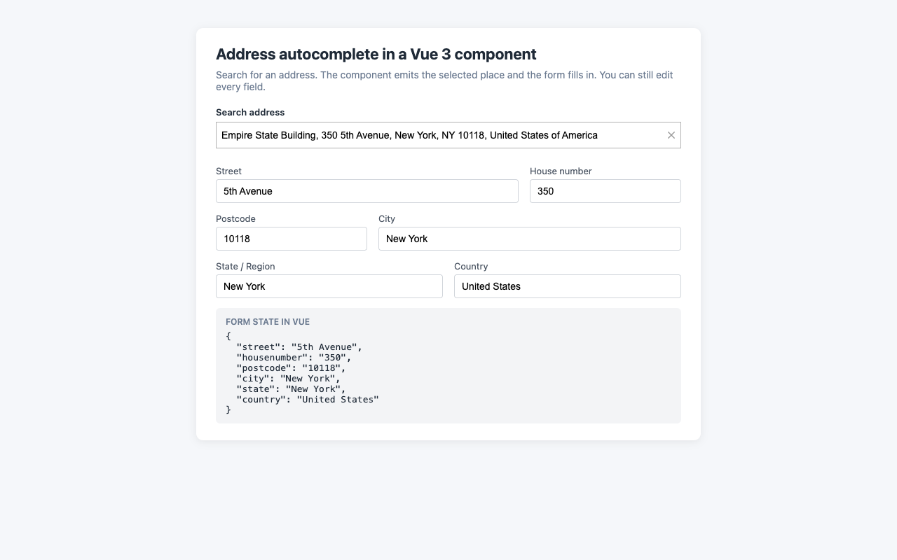

# Vue 3 Address Autocomplete: A Component That Fills an Address Form

Add address autocomplete to a Vue 3 app with a small reusable component built on [@geoapify/geocoder-autocomplete](https://www.npmjs.com/package/@geoapify/geocoder-autocomplete). The user types an address, picks a suggestion, and the component emits the selected place so the parent can fill a `v-model` address form: street, house number, postcode, city, state and country.

## Overview

- **Problem:** you need address autocomplete in a Vue 3 form, and Geoapify has no Vue-specific package.
- **Solution:** wrap the framework-free `@geoapify/geocoder-autocomplete` library in a Vue component. Create the field in `onMounted`, emit `select` with the chosen address, and call `destroy()` in `onBeforeUnmount`.
- **Stack:** HTML, CSS, JavaScript, [Vue 3](https://vuejs.org/) from a CDN (no build step).
- **API:** [Geoapify Address Autocomplete API](https://apidocs.geoapify.com/docs/geocoding/address-autocomplete/), called by the library as the user types.

The same component works in a Vite or Vue CLI project: install the library with `npm install @geoapify/geocoder-autocomplete`, import `GeocoderAutocomplete` from it, and import its CSS theme.

## Live Demo

[](https://codepen.io/editor/geoapify/pen/01a208a1-f15f-7da9-93cf-8128cbd77d9b)

## Screenshot



## Quick Start

Open [`src/index.html`](./src/index.html) in your browser. No build step is required.

## Geoapify API Key

This example includes a demo Geoapify API key that can be blocked or restricted at any time. For your own project, create a free API key at [myprojects.geoapify.com](https://myprojects.geoapify.com/) and replace `yourAPIKey` in [`src/script.js`](./src/script.js).

## Project Structure

| File | Purpose |
|------|---------|
| `src/index.html` | Loads Vue 3, the Geocoder Autocomplete library and its theme from jsDelivr |
| `src/script.js` | The `AddressAutocomplete` component and the parent form |
| `src/style.css` | Page and form styles |

## Code Samples

### The autocomplete component

The component gives the library a container element, listens for its `select` event and passes the selected address up to the parent.

```js
const AddressAutocomplete = {
  props: {
    apiKey: { type: String, required: true },
    options: { type: Object, default: () => ({}) }
  },
  emits: ["select"],
  setup(props, { emit }) {
    const container = ref(null);
    let autocompleteField = null;

    onMounted(() => {
      autocompleteField = new autocomplete.GeocoderAutocomplete(
        container.value,
        props.apiKey,
        props.options
      );
      autocompleteField.on("select", (place) => emit("select", place));
    });

    onBeforeUnmount(() => {
      if (autocompleteField) autocompleteField.destroy();
    });

    return { container };
  },
  template: `<div ref="container" class="autocomplete-container"></div>`
};
```

How it works:

- The library creates its own `<input>` and suggestion list inside the container `div`, so the component creates it only after mounting, when the element exists.
- `select` receives the chosen place as a GeoJSON feature (or `null` when the field is cleared).
- `destroy()` removes the library's event listeners and elements when Vue removes the component.
- The container needs `position: relative` so the suggestion list opens under the input.

### Fill the form from the selected address

The parent keeps the form in a `reactive` object, binds each input with `v-model` and copies the address parts from the selected place.

```js
const address = reactive({
  street: "", housenumber: "", postcode: "", city: "", state: "", country: ""
});

function onAddressSelect(place) {
  if (!place) return;
  const p = place.properties;
  address.street = p.street || "";
  address.housenumber = p.housenumber || "";
  address.postcode = p.postcode || "";
  address.city = p.city || p.town || p.village || "";
  address.state = p.state || "";
  address.country = p.country || "";
}
```

```html
<address-autocomplete
  :api-key="apiKey"
  :options="autocompleteOptions"
  @select="onAddressSelect"
></address-autocomplete>

<input v-model="address.street">
<input v-model="address.housenumber">
```

How it works:

- Every field stays editable, so the user can correct a value after selection.
- Small places may have no `city`, so the sample falls back to `town` and `village`.
- `allowNonVerifiedHouseNumber` and `allowNonVerifiedStreet` keep a house number or street the user typed even when it isn't in the map data.

## Troubleshooting

| Problem | Likely Cause | What to Do |
|---------|--------------|------------|
| The search field doesn't appear | Vue or the library failed to load from the CDN | Open DevTools (`Console` + `Network`) and check that both scripts load. |
| No suggestions / API responds `401` or `403` | The API key is invalid, restricted or over its limits | Get your own free key at [myprojects.geoapify.com](https://myprojects.geoapify.com/) and update `yourAPIKey`. |
| The suggestion list opens in the wrong place | The container has no `position: relative` | Keep the `.autocomplete-container` style from `src/style.css`. |
| Output differs from expected | Local edits changed the behaviour | Compare your files with the [CodePen demo](https://codepen.io/editor/geoapify/pen/01a208a1-f15f-7da9-93cf-8128cbd77d9b). |

## APIs and Libraries

| Name | Description | Documentation | Used In This Example |
|------|-------------|---------------|----------------------|
| Geoapify Address Autocomplete API | Address suggestions as the user types | [Docs](https://apidocs.geoapify.com/docs/geocoding/address-autocomplete/) | Called by the library from the search field |
| @geoapify/geocoder-autocomplete | Framework-free autocomplete input | [npm](https://www.npmjs.com/package/@geoapify/geocoder-autocomplete) | Wrapped in the `AddressAutocomplete` component |
| Vue 3 | Reactive UI framework | [Docs](https://vuejs.org/guide/introduction.html) | Components, `v-model` form state |

## Related Examples

| Example | Description | Link |
|---------|-------------|------|
| One-Field Address Form | Single-field address input that fills a form | [Open](../one-field-address-form-single-field-autocomplete-input) |
| Filters and Bias | Country filtering and proximity bias | [Open](../filters-bias-demonstrates-filter-and-bias-customization) |
| Events Showcase | All events and callbacks of the library | [Open](../events-showcase-demonstrates-available-events-and-callbacks) |

## Useful Links

- Tutorial on dev.to: [Address Autocomplete in Vue 3 Without a Wrapper Package (and Without Leaks)](https://dev.to/geoapify-maps-api/address-autocomplete-in-vue-3-without-a-wrapper-package-and-without-leaks-hlh)
- Geoapify API docs: [https://apidocs.geoapify.com/](https://apidocs.geoapify.com/)
- CodePen demo: [https://codepen.io/editor/geoapify/pen/01a208a1-f15f-7da9-93cf-8128cbd77d9b](https://codepen.io/editor/geoapify/pen/01a208a1-f15f-7da9-93cf-8128cbd77d9b)
- Geoapify CodePen profile: [https://codepen.io/geoapify](https://codepen.io/geoapify)

## License

MIT
