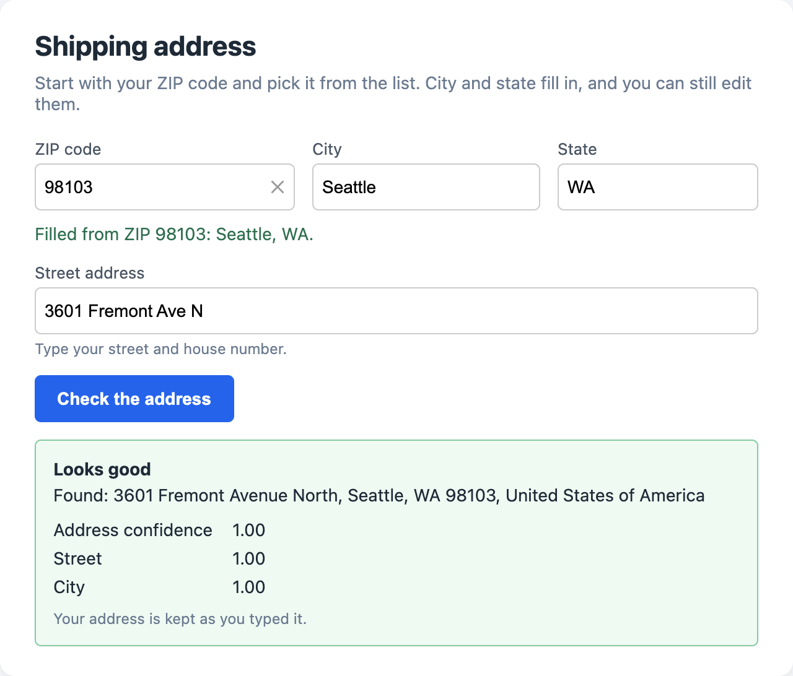

# ZIP Code Autofill: Type a ZIP Code, City and State Fill In, Then Check the Address

Fill city and state from a US ZIP code in a checkout form. The ZIP field suggests US postcodes as the user types, using [@geoapify/geocoder-autocomplete](https://www.npmjs.com/package/@geoapify/geocoder-autocomplete) with the [Geoapify Address Autocomplete API](https://apidocs.geoapify.com/docs/geocoding/address-autocomplete/). Picking a ZIP fills City and State. A "Check the address" button then geocodes the full address with the [Geoapify Geocoding API](https://apidocs.geoapify.com/docs/geocoding/forward-geocoding/) and shows how confident the match is and whether a house was found.

## Overview

- **Problem:** users type city and state by hand, with typos and different spellings, although the ZIP code already tells you both.
- **Solution:** make the ZIP field an autocomplete that searches only US postcodes (`type: "postcode"`, `filter: { countrycode: ["us"] }`), copy `city` and `state_code` from the selected postcode, and check the finished address with one Geocoding API request.
- **Stack:** HTML, CSS, JavaScript, no build step.
- **APIs:** Geoapify Address Autocomplete API (through the library) and Geoapify Geocoding API (`/v1/geocode/search`).

## Live Demo

[](https://codepen.io/editor/geoapify/pen/01a20d90-c2a7-734f-9ccb-b5f377f1b232)

## Screenshot



## Quick Start

Open [`src/index.html`](./src/index.html) in your browser. No build step is required.

The cursor starts in the ZIP field. Type a few digits (for example `0213`), pick a ZIP with the mouse or with ↑/↓ and Enter, then type a street and press **Check the address**.

## Geoapify API Key

This example includes a demo Geoapify API key that can be blocked or restricted at any time. For your own project, create a free API key at [myprojects.geoapify.com](https://myprojects.geoapify.com/) and replace `yourAPIKey` in [`src/script.js`](./src/script.js).

## Project Structure

| File | Purpose |
|------|---------|
| `src/index.html` | The form; loads the Geocoder Autocomplete library and its round-borders theme from jsDelivr |
| `src/script.js` | ZIP autocomplete, city and state autofill, the address check |
| `src/style.css` | Form styles that match the round-borders theme |

## Code Samples

### A ZIP field that suggests US postcodes only

The library creates the input inside the `#zip-field` container. `type: "postcode"` limits suggestions to postcodes, and the country filter limits them to the US.

```js
const zipField = new autocomplete.GeocoderAutocomplete(
  document.getElementById("zip-field"),
  yourAPIKey,
  {
    type: "postcode",
    filter: { countrycode: ["us"] },
    limit: 5,
    placeholder: "e.g. 02134",
    skipIcons: true,
    skipSelectionOnArrowKey: true
  }
);

// Suggestion text: "02134 · Boston, MA" instead of the full formatted address
zipField.setPostprocessHook((feature) => {
  const p = feature.properties;
  return `${p.postcode} · ${p.city || p.county || ""}, ${p.state_code}`;
});
```

How it works:

- `setPostprocessHook` sets the text of each suggestion (and of the input after a pick), so the list shows short "ZIP · City, ST" lines.
- `skipSelectionOnArrowKey: true` makes ↑/↓ only highlight a suggestion; Enter or a click selects it. Without it, every arrow key selects an item and fires `select`.
- The container needs `position: relative` so the suggestion list opens under the input.

### Fill city and state from the selected ZIP

On `select`, keep only the ZIP in the ZIP field and copy city and state into the form.

```js
zipField.on("select", (feature) => {
  if (!feature) return; // the field was cleared: keep city and state

  const p = feature.properties;
  zipField.setValue(p.postcode);

  cityInput.value = p.city || "";
  stateInput.value = p.state_code || "";

  if (p.city) {
    document.getElementById("street").focus();
  } else {
    // Some ZIP codes come back without a city: let the user type it
    cityInput.focus();
  }
});
```

How it works:

- `setValue` replaces the text in the input without sending a new request.
- `state_code` is the two-letter code (`MA`, `WA`), the usual format for US checkout forms; `state` has the full name.
- City and State stay editable. If a result has no `city`, the field stays empty and gets the focus.

### Check the address and show the confidence

The button sends the whole address as one line to the Geocoding API and reads `rank.confidence` of the best match.

```js
const GOOD_CONFIDENCE = 0.8; // each app picks its own threshold

const params = new URLSearchParams({
  text: `${street}, ${city}, ${state} ${zip}`,
  filter: "countrycode:us",
  limit: 1,
  format: "json",
  apiKey: yourAPIKey
});

fetch(`https://api.geoapify.com/v1/geocode/search?${params}`)
  .then((response) => response.json())
  .then((data) => {
    const found = data.results[0];
    if (!found) return showResult("review", "No match found.");

    // a house was found, not only a street or a postcode
    const foundHouse = ["building", "amenity"].includes(found.result_type);
    const status = found.rank.confidence >= GOOD_CONFIDENCE && foundHouse ? "good" : "review";
    // show found.formatted and found.rank.confidence,
    // confidence_street_level and confidence_city_level
  });
```

How it works:

- `rank.confidence` (0–1) says how sure the API is that the match is the address you sent. `confidence_street_level` and `confidence_city_level` do the same for the street and the city.
- A low value doesn't mean the address is wrong; it means it needs a second look. A misspelling like "3601 Fremont Avn N" still finds 3601 Fremont Avenue North, with confidence 0.63.
- Confidence doesn't tell you whether the address is complete. "Fremont Ave N" without a house number finds the street with confidence 1.00. `result_type` tells you what was found: `building` or `amenity` for a house, `street` or `postcode` when the house number is missing.
- The demo shows "Looks good" when confidence is at least 0.8 and a house was found, and "Needs review" otherwise. The typed address is never replaced.

See [Working with geocoding confidence](https://apidocs.geoapify.com/docs/geocoding/forward-geocoding/#confidence) for more.

## Troubleshooting

| Problem | Likely Cause | What to Do |
|---------|--------------|------------|
| No suggestions in the ZIP field | The library or its CSS failed to load, or the API key is invalid | Open DevTools (`Console` + `Network`) and check the CDN files and the `/v1/geocode/autocomplete` request. |
| API responds `401` or `403` | The API key is invalid, restricted or over its limits | Get your own free key at [myprojects.geoapify.com](https://myprojects.geoapify.com/) and update `yourAPIKey`. |
| Arrow keys stop working after the first pick | Each arrow key selects an item and the select handler moves the focus | Keep `skipSelectionOnArrowKey: true`. |
| The clear (×) button sits outside the ZIP input | Your own input styles also match the library's input | Style only your inputs (here `.field > input`), not `.geoapify-autocomplete-input`. |
| Output differs from expected | Local edits changed the behaviour | Compare your files with the [CodePen demo](https://codepen.io/editor/geoapify/pen/01a20d90-c2a7-734f-9ccb-b5f377f1b232). |

## APIs and Libraries

| Name | Description | Documentation | Used In This Example |
|------|-------------|---------------|----------------------|
| Geoapify Address Autocomplete API | Suggestions as the user types, here postcodes only | [Docs](https://apidocs.geoapify.com/docs/geocoding/address-autocomplete/) | ZIP field, through the library |
| Geoapify Geocoding API | Finds an address and rates the match with `rank.confidence` | [Docs](https://apidocs.geoapify.com/docs/geocoding/forward-geocoding/) | "Check the address" button |
| @geoapify/geocoder-autocomplete | Autocomplete input with themes | [npm](https://www.npmjs.com/package/@geoapify/geocoder-autocomplete) | ZIP field, `round-borders` theme |

## Related Examples

| Example | Description | Link |
|---------|-------------|------|
| Vue 3 Address Autocomplete | Full-address autocomplete in a Vue component that fills a form | [Open](../vue-address-autocomplete-component-fills-address-form) |
| One-Field Address Form | Single-field address search that fills a form | [Open](../one-field-address-form-single-field-autocomplete-input) |
| Filters and Bias | Country filtering and proximity bias | [Open](../filters-bias-demonstrates-filter-and-bias-customization) |

## Useful Links

- Tutorial on dev.to: [The ZIP Already Knows the City: Autofill City and State, Then Check the Address](https://dev.to/geoapify-maps-api/the-zip-already-knows-the-city-autofill-city-and-state-then-check-the-address-2p1c)
- Geoapify API docs: [https://apidocs.geoapify.com/](https://apidocs.geoapify.com/)
- CodePen demo: [https://codepen.io/editor/geoapify/pen/01a20d90-c2a7-734f-9ccb-b5f377f1b232](https://codepen.io/editor/geoapify/pen/01a20d90-c2a7-734f-9ccb-b5f377f1b232)
- Geoapify CodePen profile: [https://codepen.io/geoapify](https://codepen.io/geoapify)

## License

MIT
