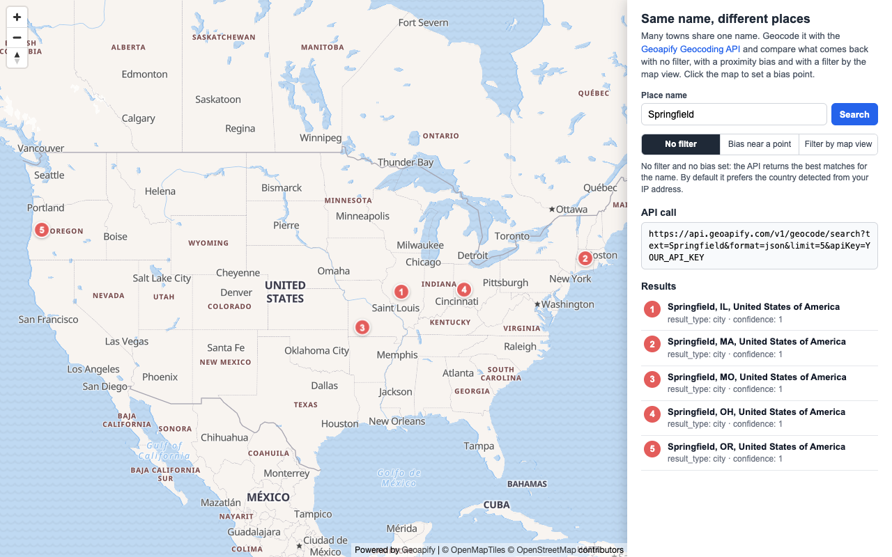

# Same Name, Different Places: Geocoding Filter and Bias on a MapLibre Map

Many towns share one name: search for "Springfield" and the answer depends on which Springfield you mean. This [MapLibre](https://maplibre.org/) example geocodes one place name with the [Geoapify Geocoding API](https://www.geoapify.com/geocoding-api/) in three modes - no filter, a proximity `bias`, and a `filter` by the visible map area - and shows the results as numbered markers, so you can see how `filter` and `bias` change which places come back.

## Overview

This example shows how to resolve ambiguous place names with the Geocoding API location parameters. `filter` restricts the results to an area: places outside it are not returned. `bias` only changes the ranking: places near the bias point come first, and other places can still be returned.

How it works:

- The panel has a place name field (default: `Springfield`) and three mode buttons: **No filter**, **Bias near a point**, and **Filter by map view**.
- **No filter** sends only the place name. With no filter and no bias set, the API returns the best matches for the name, and by default it prefers the country detected from the caller's IP address (the documented default bias `countrycode:auto`).
- **Bias near a point** adds `bias=proximity:lon,lat` for the blue point. Click the map to move the point; the sample switches to bias mode and searches again.
- **Filter by map view** adds `filter=rect:lon1,lat1,lon2,lat2` built from the visible map area. Every pan or zoom runs a new search for the new area.
- Each request asks for `limit=5`, the maximum number of results; the API can return fewer.
- The panel shows the request URL (with the API key replaced by `YOUR_API_KEY`) and a numbered list of results with `formatted`, `result_type`, and `rank.confidence`.
- Numbered markers on the map match the list. Clicking a list item flies to the marker and opens its popup.

## Live Demo

[](https://codepen.io/editor/geoapify/pen/01a1c50c-fe31-7edc-9326-9b69864b8112)

## Screenshot



## Quick Start

Open [`src/index.html`](./src/index.html) in your browser.

No local server is required.

Note: In rare cases, browser policies or extensions can restrict `file://` access. If that happens, run a local static server and open [`src/index.html`](./src/index.html) via `http://localhost`, or use your IDE's "Open with Live Server" option.

## Geoapify API Key

This example includes a demo API key for quick preview. For your own projects, create a free Geoapify API key in [Geoapify My Projects](https://myprojects.geoapify.com/). No credit card is required.

After creating a key:

1. Open [`src/script.js`](./src/script.js).
2. Replace the value of `apiKey` with your API key.
3. Refresh [`src/index.html`](./src/index.html).

Using your own key gives you access to project settings, usage statistics, and production-ready request limits.

## Code Samples

### 1. Initialize a MapLibre Map with Geoapify Tiles

This code creates a MapLibre map with a Geoapify vector map style, centered on the United States, where many towns share the same name.

```js
const apiKey = "YOUR_API_KEY";

const map = new maplibregl.Map({
  container: "map",
  style: `https://maps.geoapify.com/v1/styles/osm-bright/style.json?apiKey=${apiKey}`,
  center: [-96, 38.5],
  zoom: 3.4,
  attributionControl: { compact: false }
});

map.addControl(new maplibregl.NavigationControl(), "top-left");
```

How it works:

- `container: "map"` connects MapLibre to the `<div id="map">` element in [`src/index.html`](./src/index.html).
- The `style` URL loads Geoapify vector map tiles with the `osm-bright` style.
- `center` is `[longitude, latitude]`; zoom `3.4` shows the whole country.
- `attributionControl: { compact: false }` keeps the map attribution (Geoapify, OpenMapTiles, OpenStreetMap contributors) fully visible.

### 2. Build the Geocoding Request for Each Mode

This function builds the Geocoding API URL. The place name is always the same; only the `bias` or `filter` parameter changes with the selected mode.

```js
let biasPoint = [-72.59, 42.10]; // near Springfield, Massachusetts
let searchMode = "none";         // "none", "bias" or "filter"

function buildSearchUrl(placeName) {
  let url = `https://api.geoapify.com/v1/geocode/search?text=${encodeURIComponent(placeName)}&format=json&limit=5`;

  if (searchMode === "bias") {
    url += `&bias=proximity:${biasPoint[0]},${biasPoint[1]}`;
  }

  if (searchMode === "filter") {
    url += `&filter=rect:${getMapViewRect().join(",")}`;
  }

  return `${url}&apiKey=${apiKey}`;
}
```

Example requests for the three modes (the `rect` values come from the current map view):

```text
https://api.geoapify.com/v1/geocode/search?text=Springfield&format=json&limit=5&apiKey=YOUR_API_KEY
https://api.geoapify.com/v1/geocode/search?text=Springfield&format=json&limit=5&bias=proximity:-72.59,42.1&apiKey=YOUR_API_KEY
https://api.geoapify.com/v1/geocode/search?text=Springfield&format=json&limit=5&filter=rect:-125.0,24.5,-66.9,49.4&apiKey=YOUR_API_KEY
```

How it works:

- `encodeURIComponent()` encodes the place name, so names with spaces or special characters stay valid in the URL (for example, `New Haven` becomes `New%20Haven`).
- `format=json` returns a `results` array instead of GeoJSON.
- `limit=5` is the maximum number of results, not a guaranteed count.
- `bias=proximity:lon,lat` ranks results by distance from the point but does not exclude places farther away.
- `filter=rect:lon1,lat1,lon2,lat2` returns only places inside the rectangle, so a filter can also return no results.
- Without `bias`, the documented default bias `countrycode:auto` applies: the API detects a country from the caller's IP address and searches there first. Set `bias=countrycode:none` to turn this off.

### 3. Use the Visible Map Area as the Filter

This helper turns the current map bounds into the `rect` filter value, and a `moveend` listener runs a new search whenever the map moves in filter mode.

```js
function getMapViewRect() {
  const bounds = map.getBounds();

  return [
    Math.max(bounds.getWest(), -180),
    Math.max(bounds.getSouth(), -90),
    Math.min(bounds.getEast(), 180),
    Math.min(bounds.getNorth(), 90)
  ].map(roundCoordinate);
}

map.on("moveend", () => {
  if (searchMode === "filter") {
    searchPlaces();
  }
});

function roundCoordinate(value) {
  return Math.round(value * 10000) / 10000;
}
```

How it works:

- `map.getBounds()` returns the west, south, east, and north edges of the visible map.
- The values are clamped to valid longitude and latitude ranges, because a zoomed-out MapLibre view can extend beyond -180/180.
- The order matches the `rect:lon1,lat1,lon2,lat2` filter format.
- Coordinates are rounded to 4 decimals to keep the URL short.
- In filter mode the map does not zoom to the results, because the map view is the search area; moving it would start another search.

### 4. Move the Bias Point on Map Click

This code moves the blue bias point to the clicked location and switches to bias mode. Clicks on markers and popups are ignored.

```js
const biasMarkerElement = document.createElement("div");
biasMarkerElement.className = "bias-marker";

const biasMarker = new maplibregl.Marker({
  element: biasMarkerElement,
  anchor: "center"
}).setLngLat(biasPoint);

map.on("click", event => {
  if (event.originalEvent.target.closest(".maplibregl-marker, .maplibregl-popup")) {
    return;
  }

  biasPoint = [roundCoordinate(event.lngLat.lng), roundCoordinate(event.lngLat.lat)];
  biasMarker.setLngLat(biasPoint);
  setSearchMode("bias");
});
```

How it works:

- `event.lngLat` gives the clicked coordinates, which become the new `bias=proximity` point.
- `setSearchMode("bias")` highlights the mode button, shows the blue marker, and runs the search.
- The blue marker is only added to the map in bias mode.

### 5. Send the Request and Show Numbered Results

This code sends the request, shows the URL without the API key, and renders each result as a numbered marker and list item.

```js
let activeRequestId = 0;

function searchPlaces() {
  const placeName = placeNameInput.value.trim();

  if (!placeName) {
    return;
  }

  const requestMode = searchMode;
  const requestId = ++activeRequestId;
  const searchUrl = buildSearchUrl(placeName);

  requestUrlElement.textContent = searchUrl.replace(apiKey, "YOUR_API_KEY");

  fetch(searchUrl)
    .then(response => response.json())
    .then(data => {
      if (requestId !== activeRequestId) {
        return;
      }

      if (data.message) {
        showMessage(`Request failed: ${data.message}`);
        return;
      }

      showResults(data.results || [], requestMode);
    });
}

function showResults(results, requestMode) {
  clearResultMarkers();

  results.forEach((result, index) => {
    const markerElement = document.createElement("div");
    markerElement.className = "result-marker";
    markerElement.textContent = index + 1;

    const marker = new maplibregl.Marker({ element: markerElement, anchor: "center" })
      .setLngLat([result.lon, result.lat])
      .setPopup(new maplibregl.Popup({ offset: 16, closeButton: false }).setText(result.formatted))
      .addTo(map);

    resultMarkers.push(marker);
    // The list item shows result.formatted, result.result_type and result.rank.confidence.
  });

  if (requestMode !== "filter") {
    fitMapToResults(results, requestMode);
  }
}
```

How it works:

- `activeRequestId` drops responses from older requests, so fast map moves in filter mode do not show outdated results.
- An error response contains a `message`, which the sample shows in the result list.
- Each result has `lat` and `lon`; MapLibre markers expect `[longitude, latitude]`.
- The list shows `formatted`, `result_type` (for example, `city`), and `rank.confidence` (0 to 1; values of 0.8 and above are generally a good match).
- An empty `results` array shows "No results for this name and mode."
- `showMessage()`, `clearResultMarkers()` and the list item builder are defined in [`src/script.js`](./src/script.js).

### 6. Fit the Map to the Results

In no-filter and bias modes, this helper zooms the map to the returned places. In bias mode it also includes the bias point.

```js
function fitMapToResults(results, requestMode) {
  const bounds = new maplibregl.LngLatBounds();

  results.forEach(result => bounds.extend([result.lon, result.lat]));

  if (requestMode === "bias") {
    bounds.extend(biasPoint);
  }

  map.fitBounds(bounds, { padding: 60, maxZoom: 10, duration: 600 });
}
```

How it works:

- `LngLatBounds` grows to contain every result coordinate.
- Adding `biasPoint` keeps the blue point visible next to the results it ranked.
- `maxZoom: 10` stops the map from zooming in too far when there is only one result.

## Troubleshooting

| Problem | What to Check |
| --- | --- |
| Map is not visible | Check that the MapLibre GL JS library and CSS are loaded, the `#map` element has height, and the Geoapify API key is correct. |
| Map tiles do not load | Inspect the browser network tab for failed `maps.geoapify.com` requests. Verify that the API key is valid. |
| "Request failed" in the result list | The API returned an error message. Check the API key and the request URL shown in the panel. |
| "No results for this name and mode." in filter mode | The filter excludes every place outside the visible map area. Zoom out or pan to an area where a place with this name exists. |
| No-filter results are all in one country | This is the documented default bias `countrycode:auto`: the API prefers the country detected from your IP address. Add `bias=countrycode:none` to turn it off, or use a `filter` to choose the area. |
| Bias mode still shows places far from the point | `bias` only ranks results; it does not exclude others. Use `filter` to restrict results to an area. |
| Fewer than 5 results | `limit` is the maximum number of results, not a guaranteed count. |
| Markers appear in the wrong place | Confirm that coordinates are passed as `[longitude, latitude]`, the order MapLibre expects. |
| Output differs from expected | Compare your files with the [CodePen demo](https://codepen.io/editor/geoapify/pen/01a1c50c-fe31-7edc-9326-9b69864b8112) and align differences step by step. |

## APIs and Libraries

| Name | Description | Documentation | Used In This Example |
| --- | --- | --- | --- |
| Geoapify Geocoding API | Converts addresses and place names into coordinates, with `filter` and `bias` parameters to restrict or rank results by location. | [Forward geocoding docs](https://apidocs.geoapify.com/docs/geocoding/forward-geocoding/) | Geocodes one place name with no filter, with `bias=proximity`, and with `filter=rect` by the map view. |
| Geoapify Map Tiles | Provides the vector map style used by MapLibre GL JS. | [Map Tiles docs](https://apidocs.geoapify.com/docs/maps/) | Loads the `osm-bright` map style from `maps.geoapify.com`. |
| MapLibre GL JS | Open-source JavaScript library for rendering interactive vector maps in the browser. | [MapLibre GL JS docs](https://maplibre.org/maplibre-gl-js/docs/) | Renders the map, numbered markers, popups, click handling, map bounds for the filter, and viewport fitting. |

## Related Examples

| Example | Description | Link |
| --- | --- | --- |
| Filters and Bias: Filter and Bias Customization | Country filtering and proximity bias in the Geoapify Geocoder Autocomplete. | [Open](https://github.com/geoapify/geoapify-quickstart-examples/tree/main/geocoder-autocomplete/filters-bias-demonstrates-filter-and-bias-customization) |
| Simple Geocoding Request Playground | Build a geocoding request from UI fields, send it, and inspect the JSON response. | [Open](https://github.com/geoapify/geoapify-quickstart-examples/tree/main/geocoding-api/simple-geocoding-request) |

## Useful Links

- [Geoapify](https://www.geoapify.com/) - learn more about Geoapify APIs and location services
- [Geoapify Geocoding API](https://www.geoapify.com/geocoding-api/)
- [Geoapify Map Tiles](https://www.geoapify.com/map-tiles/)
- [Geoapify API Playground](https://apidocs.geoapify.com/playground/)
- [Geoapify My Projects](https://myprojects.geoapify.com/) - create and manage API keys
- [MapLibre Project](https://maplibre.org/)
- [Geoapify Quickstart Examples](https://github.com/geoapify/geoapify-quickstart-examples)
- CodePen demo: [https://codepen.io/editor/geoapify/pen/01a1c50c-fe31-7edc-9326-9b69864b8112](https://codepen.io/editor/geoapify/pen/01a1c50c-fe31-7edc-9326-9b69864b8112)

## License

MIT
