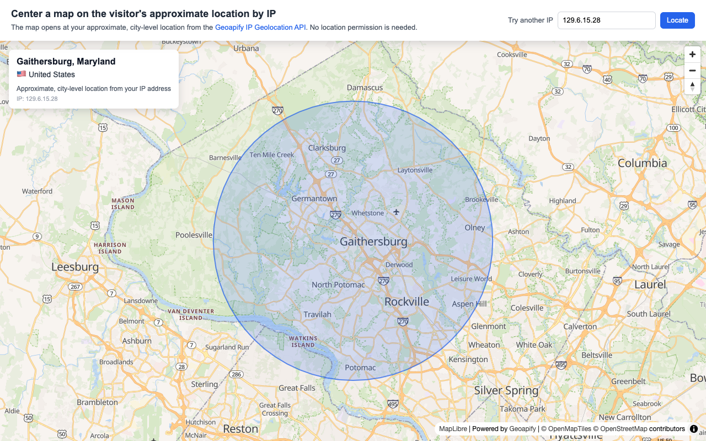
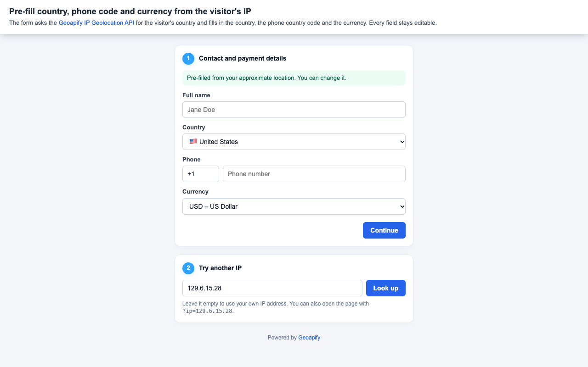

# Geoapify IP Geolocation API Code Examples

Use Geoapify IP Geolocation API examples to find a visitor's approximate location from an IP address, center a map on it, and pre-fill country-specific form fields.

## Overview

This folder contains browser-based JavaScript examples for the IP Geolocation API. Called without an `ip` parameter, the API looks up the IP address of whoever sends the request, so a browser page gets its visitor's approximate, city-level location without asking for permission. Each example includes source code, a screenshot, and a focused README with setup notes and code samples.

## API Resources

## Live Demo

Each CodePen demo is linked from the `Live Demo` column in the code examples table.

## Code Examples

| Screenshot | Example | Description | Source Code | Live Demo |
|------------|---------|-------------|-------------|-----------|
|  | Center a Map on the Visitor's Approximate Location by IP | Open a MapLibre map at the visitor's approximate, city-level location, with a fallback view and a field to try another IP address. | [Open example](https://github.com/geoapify/geoapify-quickstart-examples/tree/main/ip-geolocation-api/maplibre-center-map-on-visitor-location-by-ip/) | [CodePen](https://codepen.io/editor/geoapify/pen/01a1c4f9-8c79-7b4a-b792-873a46d49549) |
|  | Pre-fill Country, Phone Code and Currency from the Visitor's IP | Pre-fill a checkout form's country, phone code and currency from the IP Geolocation API; every field stays editable. | [Open example](https://github.com/geoapify/geoapify-quickstart-examples/tree/main/ip-geolocation-api/prefill-country-phone-currency-form-by-ip/) | [CodePen](https://codepen.io/editor/geoapify/pen/01a1c4f9-a203-71c4-a704-cf025b554b0f) |

## Geoapify API Key

These examples include demo Geoapify API keys for quick testing. For your own project, create a free API key at [myprojects.geoapify.com](https://myprojects.geoapify.com/) and replace the example key in the relevant `src/script.js` file.

## APIs and Libraries

| Name | Description | Documentation | Used In This Example |
|------|-------------|---------------|----------------------|
| Geoapify IP Geolocation API | Returns the approximate location of an IP address: city, country, coordinates, and country details. | [IP Geolocation docs](https://apidocs.geoapify.com/docs/ip-geolocation/) | [Center a Map by IP](./maplibre-center-map-on-visitor-location-by-ip/), [Pre-fill a Form by IP](./prefill-country-phone-currency-form-by-ip/) |
| Geoapify Map Tiles API | Provides the vector map style for MapLibre. | [Map Tiles docs](https://apidocs.geoapify.com/docs/maps/map-tiles/) | [Center a Map by IP](./maplibre-center-map-on-visitor-location-by-ip/) |
| MapLibre GL JS | Renders interactive vector maps in browser examples. | [MapLibre GL JS docs](https://maplibre.org/maplibre-gl-js/docs/) | [Center a Map by IP](./maplibre-center-map-on-visitor-location-by-ip/) |

## Useful Links

- Geoapify API documentation: [https://apidocs.geoapify.com/](https://apidocs.geoapify.com/)
- Geoapify projects and API keys: [https://myprojects.geoapify.com/](https://myprojects.geoapify.com/)
- Geoapify CodePen examples: [https://codepen.io/geoapify](https://codepen.io/geoapify)
