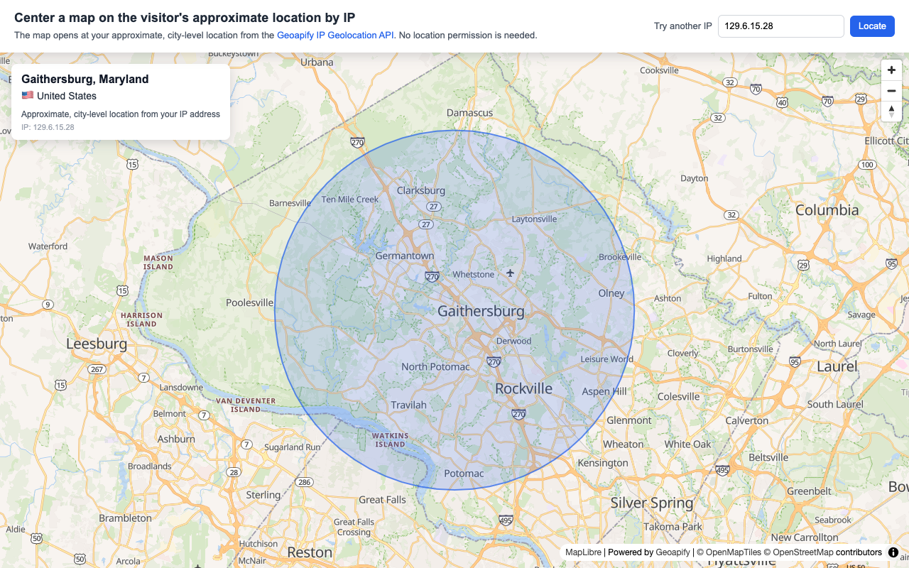

# Center a MapLibre Map on the Visitor's Location by IP with Geoapify IP Geolocation API

Open a [MapLibre](https://maplibre.org/) map at the visitor's approximate, city-level location with the [Geoapify IP Geolocation API](https://www.geoapify.com/ip-geolocation-api/). The map starts with a world view, detects the location from the visitor's IP address without asking for location permission, flies to it, and shows the city, region, and country in a small card. A form lets you look up any other IP address.

## Overview

This example shows how to set the starting view of a map from the visitor's IP address, a common way to open a store locator, delivery map, or local search near the user without a browser permission prompt.

How it works:

- The map opens with a world view and loads the Geoapify `osm-bright` vector map style.
- When the map is ready, the sample calls the IP Geolocation API `/v1/ipinfo` endpoint without the `ip` parameter, so the API uses the IP address of whoever sends the request: the visitor's browser.
- The response contains approximate coordinates in `location.latitude` and `location.longitude`. The map flies to that point at zoom 10 and draws a semi-transparent circle to show that the result is an area, not an exact point.
- A location card shows the city and state or region, the country with its flag, and the IP address that was looked up.
- The **Try another IP** field, or an `ip` URL parameter such as `index.html?ip=129.6.15.28`, looks up a different IP address.
- If the request fails or the response has no location, the map returns to the world view and the card explains what happened.

IP geolocation is approximate, usually at city level. An IP address doesn't give a street address or identify a person.

## Live Demo

[](https://codepen.io/editor/geoapify/pen/01a1c4f9-8c79-7b4a-b792-873a46d49549)

## Screenshot



## Quick Start

Open [`src/index.html`](./src/index.html) in your browser.

No local server is required.

Note: In rare cases, browser policies or extensions can restrict `file://` access. If that happens, run a local static server and open [`src/index.html`](./src/index.html) via `http://localhost`, or use your IDE's "Open with Live Server" option.

## Geoapify API Key

This example includes a demo API key for quick preview. For your own projects, create a free Geoapify API key in [Geoapify My Projects](https://myprojects.geoapify.com/). No credit card is required.

After creating a key:

1. Open [`src/script.js`](./src/script.js).
2. Replace the value of `apiKey` with your API key.
3. Refresh [`src/index.html`](./src/index.html).

Using your own key gives you access to project settings, usage statistics, and production-ready request limits. Each IP Geolocation request costs 1 credit; see [IP Geolocation API pricing](https://apidocs.geoapify.com/docs/ip-geolocation/#pricing).

## Code Samples

### 1. Initialize a MapLibre Map with a Default World View

This code creates a MapLibre map with Geoapify vector tiles. The map starts with a world view, which is also used as the fallback when no location is detected.

```js
const apiKey = "YOUR_API_KEY";

const defaultView = {
  center: [0, 25],
  zoom: 1.3
};

const map = new maplibregl.Map({
  container: "map",
  style: `https://maps.geoapify.com/v1/styles/osm-bright/style.json?apiKey=${apiKey}`,
  center: defaultView.center,
  zoom: defaultView.zoom
});

map.addControl(new maplibregl.NavigationControl(), "top-right");
```

How it works:

- `container: "map"` connects MapLibre to the `<div id="map">` element in [`src/index.html`](./src/index.html).
- The `style` URL loads the Geoapify `osm-bright` vector map style and passes the API key as a query parameter.
- `defaultView` keeps the world view in one place, so the same values can be reused for the fallback.
- `NavigationControl` adds zoom and rotation controls to the map.

### 2. Detect the Visitor's Location with the IP Geolocation API

This function requests the location for an IP address. When `ip` is empty, the request has no `ip` parameter, and the API locates the IP address the request comes from.

```js
function locateByIp(ip) {
  const ipParam = ip ? `ip=${encodeURIComponent(ip)}&` : "";
  const ipInfoUrl = `https://api.geoapify.com/v1/ipinfo?${ipParam}apiKey=${apiKey}`;

  fetch(ipInfoUrl)
    .then(response => {
      if (response.status !== 200) {
        showFallback(`The request failed with status ${response.status}.`);
        return;
      }

      return response.json().then(ipInfo => {
        if (!ipInfo.location) {
          showFallback("The response has no location for this IP address.");
          return;
        }

        showLocation(ipInfo);
      });
    });
}
```

How it works:

- `https://api.geoapify.com/v1/ipinfo` is the IP Geolocation API endpoint.
- Without the `ip` parameter, the API uses the IP address of whoever sends the request. Called from the browser, that's the visitor's IP address.
- With `ip=...`, the API looks up that IPv4 or IPv6 address instead. `encodeURIComponent()` keeps IPv6 addresses with `:` safe in the URL.
- The sample checks the HTTP status and the `location` field before using the result, and shows the fallback view otherwise.
- In [`src/script.js`](./src/script.js), the function also keeps a request counter, so a slow older response can't overwrite a newer lookup.

If you call the API from your backend, the request comes from your server's IP address, so pass the visitor's IP address in the `ip` parameter.

### 3. Fly to the Location and Show the Place Name

This code moves the map to the coordinates from the response and fills the location card with the city, region, country, and IP address.

```js
const areaRadiusMeters = 15000;
const locationZoom = 10;

function showLocation(ipInfo) {
  const center = [ipInfo.location.longitude, ipInfo.location.latitude];

  map.getSource("approximate-area").setData(circlePolygon(center, areaRadiusMeters));
  map.flyTo({
    center,
    zoom: locationZoom,
    duration: 2000
  });

  locationCard.replaceChildren();

  const place = document.createElement("h2");
  place.textContent = [ipInfo.city && ipInfo.city.name, ipInfo.state && ipInfo.state.name]
    .filter(Boolean)
    .join(", ") || "Unknown city";
  locationCard.appendChild(place);

  if (ipInfo.country) {
    const country = document.createElement("p");
    country.textContent = [ipInfo.country.flag, ipInfo.country.name].filter(Boolean).join(" ");
    locationCard.appendChild(country);
  }
}
```

How it works:

- MapLibre expects coordinates as `[longitude, latitude]`, so the sample builds the center from `location.longitude` and `location.latitude`.
- `flyTo()` animates the map from the world view to the detected city at zoom 10.
- `city.name`, `state.name`, `country.name`, and `country.flag` come from the response. A field can be missing when there is no data for it, so each one is checked before use.
- The card in [`src/script.js`](./src/script.js) also adds a note that the location is approximate and the `ip` value from the response.

For `ip=129.6.15.28`, a public NIST time server, the [API reference](https://apidocs.geoapify.com/docs/ip-geolocation/#api) shows this shortened response:

```json
{
  "ip": "129.6.15.28",
  "city": { "name": "Gaithersburg" },
  "state": { "name": "Maryland" },
  "country": { "name": "United States", "iso_code": "US", "flag": "🇺🇸" },
  "location": { "latitude": 39.1402, "longitude": -77.2185 }
}
```

### 4. Draw the Approximate Area as a Circle

IP geolocation gives an approximate location, so the sample draws a circle instead of a precise marker. The circle is a GeoJSON polygon added as a fill and outline layer.

```js
map.on("load", () => {
  map.addSource("approximate-area", {
    type: "geojson",
    data: { type: "FeatureCollection", features: [] }
  });

  map.addLayer({
    id: "approximate-area-fill",
    type: "fill",
    source: "approximate-area",
    paint: { "fill-color": "#2563eb", "fill-opacity": 0.18 }
  });

  map.addLayer({
    id: "approximate-area-outline",
    type: "line",
    source: "approximate-area",
    paint: { "line-color": "#2563eb", "line-width": 2, "line-opacity": 0.7 }
  });
});

function circlePolygon(center, radiusMeters, steps = 64) {
  const earthRadius = 6371008.8;
  const [lon, lat] = center;
  const latRad = lat * Math.PI / 180;
  const coordinates = [];

  for (let i = 0; i <= steps; i++) {
    const angle = (i / steps) * 2 * Math.PI;
    const dLat = (radiusMeters * Math.cos(angle)) / earthRadius;
    const dLon = (radiusMeters * Math.sin(angle)) / (earthRadius * Math.cos(latRad));

    coordinates.push([lon + dLon * 180 / Math.PI, lat + dLat * 180 / Math.PI]);
  }

  return {
    type: "FeatureCollection",
    features: [{
      type: "Feature",
      properties: {},
      geometry: { type: "Polygon", coordinates: [coordinates] }
    }]
  };
}
```

How it works:

- The `approximate-area` GeoJSON source starts empty and is filled with `setData()` after each successful lookup.
- `circlePolygon()` builds a 64-point polygon around the center, adjusting the longitude step for latitude so the circle looks round on the map.
- The 15 km radius is illustrative only. The IP Geolocation API doesn't return an accuracy radius.
- On fallback, the sample sets the source back to an empty `FeatureCollection` to remove the circle.

### 5. Look Up Another IP Address

This code connects the **Try another IP** form and the optional `ip` URL parameter to the same lookup function.

```js
const ipForm = document.getElementById("ip-form");
const ipInput = document.getElementById("ip-input");

ipForm.addEventListener("submit", event => {
  event.preventDefault();
  locateByIp(ipInput.value.trim());
});

map.on("load", () => {
  const ipFromUrl = new URLSearchParams(window.location.search).get("ip") || "";
  ipInput.value = ipFromUrl;
  locateByIp(ipFromUrl);
});
```

How it works:

- Submitting the form calls `locateByIp()` with the trimmed input value. An empty field locates the visitor's own IP address again.
- When the page opens with `?ip=...`, that address is looked up first and shown in the input field.
- Without the URL parameter, the first lookup runs with an empty value, so the map opens at the visitor's location.
- The lookup starts inside the map `load` handler, so the `approximate-area` source exists before the first result arrives.

### 6. Fall Back to the World View

When no location is available, the map flies back to the default view and the card explains what happened.

```js
function showFallback(message) {
  map.getSource("approximate-area").setData({ type: "FeatureCollection", features: [] });
  map.flyTo({
    center: defaultView.center,
    zoom: defaultView.zoom,
    duration: 1500
  });

  locationCard.replaceChildren();

  const title = document.createElement("h2");
  title.textContent = "Couldn't detect a location";
  locationCard.appendChild(title);

  if (message) {
    const details = document.createElement("p");
    details.textContent = message;
    locationCard.appendChild(details);
  }
}
```

How it works:

- The same `defaultView` from the map setup is reused, so the fallback always matches the starting view.
- The circle is removed so an old area doesn't stay on the map after a failed lookup.
- The message comes from `locateByIp()` and tells whether the request failed or the response had no location.

## Troubleshooting

| Problem | What to Check |
| --- | --- |
| Map is not visible | Check that the MapLibre GL JS library and CSS are loaded, the `#map` element has height, and the Geoapify API key is correct. |
| Map tiles do not load | Inspect the browser network tab for failed `maps.geoapify.com` requests. Verify that the API key is valid and allowed to use Geoapify map tiles. |
| The card shows "Couldn't detect a location" | Open the `api.geoapify.com/v1/ipinfo` request in the network tab and check its HTTP status. `401` means the API key is missing or invalid, `429` means the rate limit was exceeded, and `400` means the `ip` value isn't a valid IP address. |
| The map shows a different city than expected | IP geolocation is approximate. A VPN, proxy, corporate network, or mobile carrier can make the IP address appear in another city. Use the browser Geolocation API when you need the user's precise position and they agree to share it. |
| The location is your server's, not the visitor's | When the API is called from a backend without `ip`, it locates the server. Pass the visitor's IP address in the `ip` parameter. |
| The map doesn't move to the detected location | Confirm that coordinates are passed as `[longitude, latitude]`, which is the order expected by MapLibre and GeoJSON. |
| Output differs from expected | Compare your files with the [CodePen demo](https://codepen.io/editor/geoapify/pen/01a1c4f9-8c79-7b4a-b792-873a46d49549) and align differences step by step. |

## APIs and Libraries

| Name | Description | Documentation | Used In This Example |
| --- | --- | --- | --- |
| Geoapify IP Geolocation API | Returns the approximate location, city, region, and country for an IP address, or for the IP address that sends the request. | [IP Geolocation API docs](https://apidocs.geoapify.com/docs/ip-geolocation/) | Detects the visitor's city-level location to center the map and looks up other IP addresses from the form. |
| Geoapify Map Tiles | Provides the vector map style used by MapLibre GL JS. | [Map Tiles docs](https://apidocs.geoapify.com/docs/maps/) | Loads the `osm-bright` map style from `maps.geoapify.com`. |
| MapLibre GL JS | Open-source JavaScript library for rendering interactive vector maps in the browser. | [MapLibre GL JS docs](https://maplibre.org/maplibre-gl-js/docs/) | Renders the map, navigation controls, the approximate-area circle layers, and the `flyTo()` animation. |

## Related Examples

| Example | Description | Link |
| --- | --- | --- |
| What Is My Current Elevation? | MapLibre elevation finder that can get the user's coordinates from the browser or the Geoapify IP Geolocation API. | [Open](https://github.com/geoapify/geoapify-quickstart-examples/tree/main/elevation-api/what-is-my-current-elevation-tool) |
| Prefill a Form by IP | Prefills the country, phone code, and currency fields of a form from the visitor's IP address. | [Open](https://github.com/geoapify/geoapify-quickstart-examples/tree/main/ip-geolocation-api/prefill-country-phone-currency-form-by-ip) |
| MapLibre Map Tiles Starter | Minimal MapLibre GL JS setup with Geoapify vector map tiles. | [Open](https://github.com/geoapify/geoapify-quickstart-examples/tree/main/maps/maplibre-geoapify-map-tiles-starter) |

## Useful Links

- [Geoapify](https://www.geoapify.com/) - learn more about Geoapify APIs and location services
- [Geoapify IP Geolocation API](https://www.geoapify.com/ip-geolocation-api/)
- [Geoapify Map Tiles](https://www.geoapify.com/map-tiles/)
- [Geoapify IP Geolocation API Playground](https://apidocs.geoapify.com/playground/ip-geolocation/)
- [Geoapify My Projects](https://myprojects.geoapify.com/) - create and manage API keys
- [MapLibre Project](https://maplibre.org/)
- [Geoapify Quickstart Examples](https://github.com/geoapify/geoapify-quickstart-examples)
- CodePen demo: [https://codepen.io/editor/geoapify/pen/01a1c4f9-8c79-7b4a-b792-873a46d49549](https://codepen.io/editor/geoapify/pen/01a1c4f9-8c79-7b4a-b792-873a46d49549)
- Geoapify CodePen profile: [https://codepen.io/geoapify](https://codepen.io/geoapify)

## License

MIT
