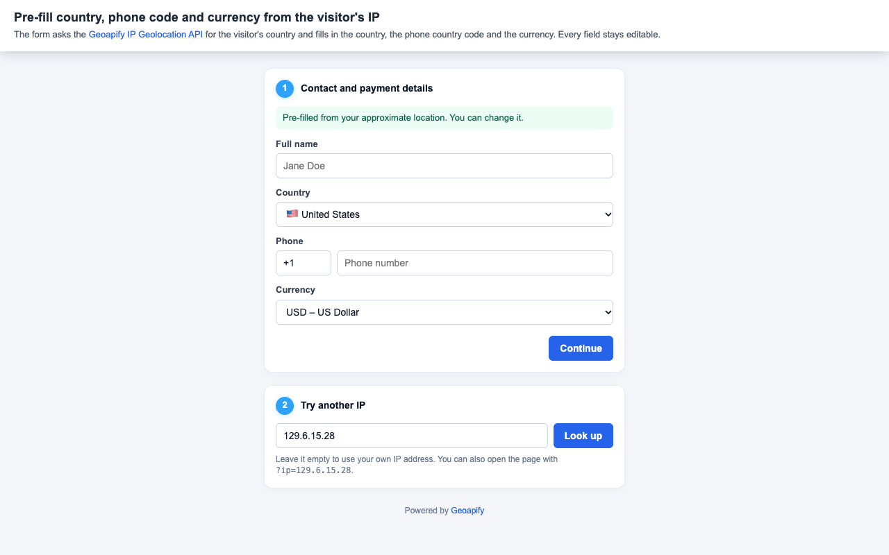

# Pre-fill Country, Phone Code and Currency from the Visitor's IP with Geoapify IP Geolocation API

Pre-fill a checkout or sign-up form from the visitor's IP address with the [Geoapify IP Geolocation API](https://www.geoapify.com/ip-geolocation-api/). One request to `/v1/ipinfo` returns the visitor's country, and the form fills in the country, the phone country code and the currency. Every field stays editable, so the visitor can correct anything before continuing.

## Overview

This example is a plain HTML, CSS and JavaScript form with no libraries. It calls the IP Geolocation API once when the page opens and uses the `country` object from the response to pre-fill three fields.

How it works:

- When the page loads, the sample sends a request to `https://api.geoapify.com/v1/ipinfo` without the `ip` parameter, so the API uses the IP address of whoever sends the request — in a browser, the visitor's IP.
- The Country select is set from `country.iso_code`, the phone prefix from `country.phone_code` (with a `+` added), and the Currency select from `country.currency`.
- The country and currency lists are built in the browser with `Intl.DisplayNames` and `Intl.supportedValuesOf("currency")`, and country options show a flag emoji built from the two-letter code.
- A note above the fields says that the values come from the approximate location and can be changed.
- If the request fails or the response has no country, the sample clears the three fields and shows a short message asking the visitor to fill them in.
- The "Try another IP" form looks up any IP address you enter, and you can also open the page with `?ip=...` in the URL.
- The Continue button doesn't send the form anywhere; it only shows the chosen values below the form.

Why the fields stay editable: an IP address gives an approximate location, and the visitor may be travelling, on a VPN or on a corporate network. The pre-filled values are a starting point, not a decision.

## Live Demo

[](https://codepen.io/editor/geoapify/pen/01a1c4f9-a203-71c4-a704-cf025b554b0f)

## Screenshot



## Quick Start

Open [`src/index.html`](./src/index.html) in your browser.

No local server is required.

Note: In rare cases, browser policies or extensions can restrict `file://` access. If that happens, run a local static server and open [`src/index.html`](./src/index.html) via `http://localhost`, or use your IDE's "Open with Live Server" option.

## Geoapify API Key

This example includes a demo API key for quick preview. For your own projects, create a free Geoapify API key in [Geoapify My Projects](https://myprojects.geoapify.com/). No credit card is required.

After creating a key:

1. Open [`src/script.js`](./src/script.js).
2. Replace the value of `yourAPIKey` with your API key.
3. Refresh [`src/index.html`](./src/index.html).

Using your own key gives you access to project settings, usage statistics, and production-ready request limits.

## Code Samples

### 1. Request the Visitor's Location with the IP Geolocation API

This function calls the IP Geolocation API and passes the result to the pre-fill code. When no IP address is given, it leaves out the `ip` parameter so the API looks up the visitor's own IP.

```js
const yourAPIKey = "YOUR_API_KEY";

function lookUpIp(ip) {
  const params = new URLSearchParams({ apiKey: yourAPIKey });
  if (ip) params.set("ip", ip); // without "ip", the API uses the IP of whoever sends the request

  fetch(`https://api.geoapify.com/v1/ipinfo?${params}`)
    .then((response) => response.json().then((data) => ({ ok: response.ok, data })))
    .then(({ ok, data }) => {
      if (!ok || !data.country) {
        clearPrefill("Couldn't detect your country. Please fill in the fields.");
        return;
      }
      applyPrefill(data);
    });
}
```

How it works:

- `URLSearchParams` builds the query string with the API key and, only when set, the `ip` parameter.
- Called from a browser without `ip`, the API uses the visitor's IP address. Called from a backend, it would use the server's IP, so a server would pass the visitor's IP in `ip`.
- `response.ok` is checked before using the data, so an unsuccessful response doesn't pre-fill anything.
- A response without a `country` object is also treated as "nothing to pre-fill".
- In [`src/script.js`](./src/script.js), the failure messages are slightly more detailed (the HTTP status is included); they are shortened here.

### 2. Pre-fill Country, Phone Code and Currency

This function copies three values from the `country` object into the form. It only sets values; the visitor can still change every field.

```js
function applyPrefill(data) {
  const country = data.country;

  // Country: the select value is the two-letter ISO code
  if (country.iso_code) {
    if (!hasOption(countrySelect, country.iso_code)) {
      addCountryOption(country.iso_code, country.name || country.iso_code);
    }
    countrySelect.value = country.iso_code;
  }

  // Phone: the API returns the calling code without "+"
  phonePrefixInput.value = country.phone_code ? `+${country.phone_code}` : "";

  // Currency: can be one code or several, separated by commas
  const currencies = (country.currency || "").split(",").map((code) => code.trim()).filter(Boolean);
  currencies.forEach((code) => {
    if (!hasOption(currencySelect, code)) addCurrencyOption(code);
  });
  currencySelect.value = currencies.length ? currencies[0] : "";

  prefillNote.textContent = "Pre-filled from your approximate location. You can change it.";
}
```

How it works:

- `country.iso_code` is the two-letter country code, which is also the value of each option in the Country select. If the code isn't in the list yet, an option is added with `country.name`.
- `country.phone_code` comes without the `+`, so the sample adds it before writing it into the phone prefix field.
- `country.currency` can list several codes, separated by commas. The sample splits it, adds any code that's missing from the Currency select, and selects the first one.
- If a field has no value in the response, the phone prefix and currency are left empty for the visitor to fill in.
- The note tells the visitor that the values are a suggestion and can be changed.

### 3. Build the Country and Currency Lists in the Browser

This code fills both selects once when the page loads, without any extra data files. Country names, currency names and flag emojis come from the browser.

```js
const regionNames = new Intl.DisplayNames(["en"], { type: "region" });
const currencyNames = new Intl.DisplayNames(["en"], { type: "currency" });

// Turns "US" into a flag emoji (two regional indicator symbols)
function flagEmoji(isoCode) {
  return String.fromCodePoint(...[...isoCode].map((letter) => 0x1f1a5 + letter.charCodeAt(0)));
}

function addCountryOption(isoCode, name) {
  const option = document.createElement("option");
  option.value = isoCode;
  option.textContent = `${flagEmoji(isoCode)} ${name}`;
  countrySelect.appendChild(option);
}

function addCurrencyOption(code) {
  const option = document.createElement("option");
  option.value = code;
  option.textContent = `${code} – ${currencyNames.of(code)}`;
  currencySelect.appendChild(option);
}

countryCodes
  .map((code) => ({ code, name: regionNames.of(code) }))
  .sort((a, b) => a.name.localeCompare(b.name))
  .forEach((country) => addCountryOption(country.code, country.name));

Intl.supportedValuesOf("currency").forEach(addCurrencyOption);
```

How it works:

- `countryCodes` in [`src/script.js`](./src/script.js) is a list of two-letter ISO 3166-1 country codes.
- `Intl.DisplayNames` turns a country code into an English country name and a currency code into a currency name.
- The countries are sorted by name before they are added to the select.
- `flagEmoji()` converts each letter of the country code into a regional indicator symbol; together, two symbols show as a flag on most systems.
- `Intl.supportedValuesOf("currency")` returns the currency codes the browser knows.

### 4. Look Up Another IP Address

The second form lets you test the pre-fill with any IP address. The page also reads an `ip` value from its own URL when it opens.

```js
document.getElementById("ip-form").addEventListener("submit", (event) => {
  event.preventDefault();
  lookUpIp(ipInput.value.trim());
});

const ipFromUrl = new URLSearchParams(window.location.search).get("ip") || "";
ipInput.value = ipFromUrl;
lookUpIp(ipFromUrl);
```

How it works:

- Submitting the "Try another IP" form calls `lookUpIp()` with the entered address, which is sent as the `ip` parameter.
- An empty field means no `ip` parameter, so the lookup goes back to your own IP address.
- On page load, `?ip=129.6.15.28` in the URL is used as the first lookup; without it, the page looks up the visitor's IP.

## Troubleshooting

| Problem | What to Check |
| --- | --- |
| Fields are not pre-filled and an error message is shown | Check that the API key is valid and inspect the `api.geoapify.com/v1/ipinfo` request in the browser network tab. |
| A wrong country is pre-filled | An IP address gives an approximate location. A VPN, a proxy, a corporate network or travel can change the result. The fields stay editable for this reason. |
| The pre-fill uses your server's location | When the request is sent from a backend, the API sees the server's IP address. Pass the visitor's IP address in the `ip` parameter. |
| "Try another IP" shows an error | Check that the entered value is a valid IPv4 or IPv6 address. |
| Flags show as two letters | Some systems don't display flag emojis. The country names and codes still work. |
| Output differs from expected | Compare your files with the [CodePen demo](https://codepen.io/editor/geoapify/pen/01a1c4f9-a203-71c4-a704-cf025b554b0f) and align differences step by step. |

## APIs and Libraries

| Name | Description | Documentation | Used In This Example |
| --- | --- | --- | --- |
| Geoapify IP Geolocation API | Returns the approximate location of an IP address: city, state, country with its code, phone code and currency, continent and coordinates. | [IP Geolocation API docs](https://apidocs.geoapify.com/docs/ip-geolocation/) | Detects the visitor's country and provides `country.iso_code`, `country.phone_code` and `country.currency` for the form. |
| Intl.DisplayNames (browser API) | Built-in JavaScript API that returns display names for regions, currencies and languages. | [MDN: Intl.DisplayNames](https://developer.mozilla.org/en-US/docs/Web/JavaScript/Reference/Global_Objects/Intl/DisplayNames) | Turns country and currency codes into English names for the select options. |
| Intl.supportedValuesOf (browser API) | Built-in JavaScript function that lists the values the browser supports, such as currency codes. | [MDN: Intl.supportedValuesOf](https://developer.mozilla.org/en-US/docs/Web/JavaScript/Reference/Global_Objects/Intl/supportedValuesOf) | Builds the list of currencies in the Currency select. |

## Related Examples

| Example | Description | Link |
| --- | --- | --- |
| Center a MapLibre Map on the Visitor's Location by IP | Uses the IP Geolocation API to open a MapLibre map at the visitor's approximate location. | [Open](https://github.com/geoapify/geoapify-quickstart-examples/tree/main/ip-geolocation-api/maplibre-center-map-on-visitor-location-by-ip) |
| One-Field Address Form | Single-field address input with Geoapify Geocoder Autocomplete that fills the address fields. | [Open](https://github.com/geoapify/geoapify-quickstart-examples/tree/main/geocoder-autocomplete/one-field-address-form-single-field-autocomplete-input) |

## Useful Links

- [Geoapify](https://www.geoapify.com/) - learn more about Geoapify APIs and location services
- [Geoapify IP Geolocation API](https://www.geoapify.com/ip-geolocation-api/)
- [Geoapify API Documentation](https://apidocs.geoapify.com/)
- [Geoapify My Projects](https://myprojects.geoapify.com/) - create and manage API keys
- CodePen demo: [https://codepen.io/editor/geoapify/pen/01a1c4f9-a203-71c4-a704-cf025b554b0f](https://codepen.io/editor/geoapify/pen/01a1c4f9-a203-71c4-a704-cf025b554b0f)
- Geoapify CodePen profile: [https://codepen.io/geoapify](https://codepen.io/geoapify)
- [Geoapify Quickstart Examples](https://github.com/geoapify/geoapify-quickstart-examples)

## License

MIT
