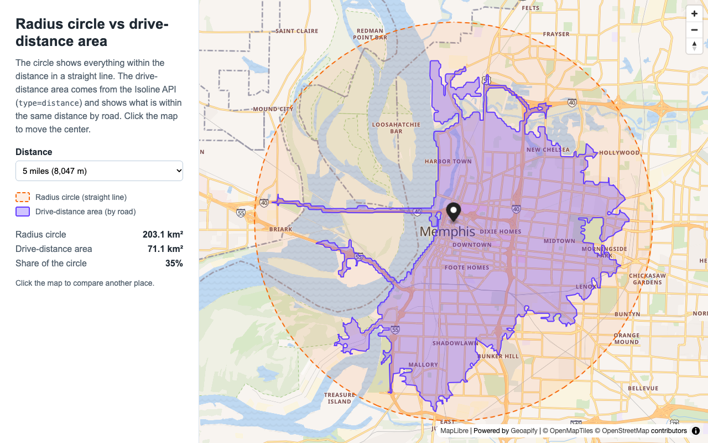

# Radius Circle vs Drive-Distance Area on a Map

Draw a radius circle on a map and the drive-distance area for the same distance: a circle polygon in meters for the straight line, and a Geoapify Isoline API isodistance (`type=distance`) for the distance by road, both on a MapLibre map.

## Overview

A radius circle answers "what is within 5 miles?" in a straight line. A drive-distance area answers it along the road network. This example draws both for the same center and the same distance and shows how much of the circle you can really reach by car.

It opens on downtown Memphis, Tennessee, with 5 miles (8,047 m). The circle covers 203.1 km², the drive-distance area 71.1 km², about 35% of the circle: the Mississippi River can be crossed only on bridges, and streets don't run in straight lines from the center. Pick another distance (3 km, 5 km, 5 miles or 10 km) or click the map to move the center. The circle appears at once; the drive-distance area needs one Isoline API request.

| Distance | Radius circle | Drive-distance area | Share |
|----------|---------------|---------------------|-------|
| 3 km | 28.2 km² | 11.9 km² | 42% |
| 5 miles (8,047 m) | 203.1 km² | 71.1 km² | 35% |

## Live Demo

[](https://codepen.io/editor/geoapify/pen/01a1eeaf-ea47-703a-b581-a8170b297245)

## Screenshot



## Quick Start

Open [`src/index.html`](./src/index.html) in your browser.

No build step is required.

## Geoapify API Key

This example includes a demo Geoapify API key. For your own project, create a free API key at [myprojects.geoapify.com](https://myprojects.geoapify.com/) and replace the `apiKey` value in [`src/script.js`](./src/script.js).

## Project Structure

| File | Purpose |
|------|---------|
| `src/index.html` | Page layout, distance selector, legend and stats |
| `src/script.js` | Map setup, the circle polygon, the Isoline API request, map layers and areas |
| `src/style.css` | Panel, legend and stats styles |

## Key Code Samples

### Create the Radius Circle as a GeoJSON Polygon

MapLibre's `circle` layer draws points with a radius in pixels, so the circle is built as a polygon in meters. The function places 64 points around the center with the great-circle destination formula and closes the ring.

```js
function circlePolygon(lon, lat, radiusMeters, steps = 64) {
  const earthRadius = 6371008.8;
  const toRad = (degrees) => (degrees * Math.PI) / 180;
  const toDeg = (radians) => (radians * 180) / Math.PI;
  const angularDistance = radiusMeters / earthRadius;
  const lat1 = toRad(lat);
  const lon1 = toRad(lon);
  const ring = [];
  for (let i = 0; i <= steps; i++) {
    const bearing = (2 * Math.PI * i) / steps;
    const lat2 = Math.asin(
      Math.sin(lat1) * Math.cos(angularDistance) +
        Math.cos(lat1) * Math.sin(angularDistance) * Math.cos(bearing)
    );
    const lon2 =
      lon1 +
      Math.atan2(
        Math.sin(bearing) * Math.sin(angularDistance) * Math.cos(lat1),
        Math.cos(angularDistance) - Math.sin(lat1) * Math.sin(lat2)
      );
    ring.push([toDeg(lon2), toDeg(lat2)]);
  }
  return { type: "Feature", properties: {}, geometry: { type: "Polygon", coordinates: [ring] } };
}

const radiusCircle = circlePolygon(-90.049, 35.1495, 8047);
```

How it works:

- No API request is needed: the circle is calculated in the browser.
- Points are calculated on the sphere, so the circle stays round at any latitude.
- In Leaflet, `L.circle([lat, lon], { radius: 8047 })` takes meters directly.

### Request the Drive-Distance Area

The Isoline API returns the area reachable within a distance along roads when `type=distance`. The `range` is in meters.

```js
async function getDriveDistanceArea(lon, lat, distance) {
  const params = new URLSearchParams({
    lat,
    lon,
    type: "distance",
    mode: "drive",
    range: distance, // meters
    apiKey,
  });
  let response = await fetch(`https://api.geoapify.com/v1/isoline?${params}`);

  // 202: the isoline is still being calculated. Ask for it again by its id.
  while (response.status === 202) {
    const { properties } = await response.json();
    await new Promise((resolve) => setTimeout(resolve, 1000));
    response = await fetch(`https://api.geoapify.com/v1/isoline?id=${properties.id}&apiKey=${apiKey}`);
  }
  return response.json();
}
```

How it works:

- The response is a GeoJSON FeatureCollection with one (Multi)Polygon feature, ready for a MapLibre `geojson` source.
- Use `mode=walk` or `mode=bicycle` to measure the distance on the network for that mode.
- A distance isoline costs 1 credit per 5 km, so 8,047 m costs 2 credits. The available range depends on your [plan](https://www.geoapify.com/pricing/); the Free plan calculates isodistances up to 10 km.

### Draw Both Areas

The circle goes below the drive-distance area, so the space between the two outlines is what lies within the distance on the map but farther by road.

```js
map.addSource("radius-circle", { type: "geojson", data: radiusCircle });
map.addLayer({
  id: "radius-circle-outline",
  type: "line",
  source: "radius-circle",
  paint: { "line-color": "#f76707", "line-width": 2, "line-dasharray": [3, 2] },
});

map.addSource("drive-distance", { type: "geojson", data: driveDistanceArea });
map.addLayer({
  id: "drive-distance-fill",
  type: "fill",
  source: "drive-distance",
  paint: { "fill-color": "#623aff", "fill-opacity": 0.3 },
});
```

How it works:

- The drive-distance area always lies inside the circle, because a route on roads is never shorter than the straight line.
- On a map click, the sample replaces both sources' data and ignores a response that arrives after a newer click.
- The panel compares the two areas, calculated on the sphere from the polygons.

## APIs and Libraries

| Name | Description | Documentation | Used In This Example |
|------|-------------|---------------|----------------------|
| [Geoapify Isoline API](https://www.geoapify.com/isoline-api/) | Calculates areas reachable within a time (isochrone) or distance (isodistance) as GeoJSON. | [Isoline API docs](https://apidocs.geoapify.com/docs/isolines/) | Drive-distance area |
| [Geoapify Map Tiles API](https://www.geoapify.com/map-tiles/) | Provides the OSM Bright map style for MapLibre. | [Map Tiles docs](https://apidocs.geoapify.com/docs/maps/map-tiles/) | Base map |
| [MapLibre GL JS](https://maplibre.org/) | Renders the interactive vector map. | [MapLibre GL JS docs](https://maplibre.org/maplibre-gl-js/docs/) | Circle and isoline layers, marker |

## Related Code Samples

| Code Sample | Why It Is Related |
|-------------|-------------------|
| [Multi-Range Isochrones](https://github.com/geoapify/geoapify-quickstart-examples/tree/main/isoline-api/geoapify-isoline-api-maplibre-gl-multi-range-isochrones-with-toggle-ranges) | Several time or distance ranges with MapLibre GL |
| [Reachability Zones + Places](https://github.com/geoapify/geoapify-quickstart-examples/tree/main/isoline-api/reachability-zones-places-maplibre-gl) | Places inside a reachable area |

## Useful Links

- Tutorial on dev.to: [A 5-Mile Radius Isn't 5 Miles by Car: Draw Both on a Map with JavaScript](https://dev.to/geoapify-maps-api/a-5-mile-radius-isnt-5-miles-by-car-draw-both-on-a-map-with-javascript-5che)
- How-to guide: [How to Draw a Radius Circle on a Map and Compare It With a Drive-Distance Area](https://apidocs.geoapify.com/how-to/location-analysis/radius-circle-vs-drive-distance/)
- Geoapify API documentation: [https://apidocs.geoapify.com/](https://apidocs.geoapify.com/)
- Geoapify CodePen examples: [https://codepen.io/geoapify](https://codepen.io/geoapify)

## License

MIT
