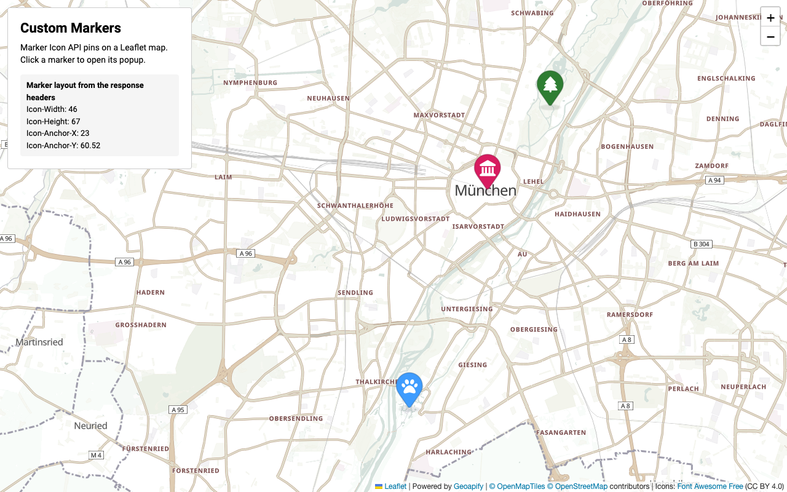

# Custom Marker Icons with Popups on a Leaflet Map

Add custom Leaflet markers with popups using pins from the [Geoapify Marker Icon API](https://www.geoapify.com/map-marker-icon-api/). The sample reads each marker's display size and anchor from the response headers, so the pin tip lands exactly on its location.

## Overview

A Leaflet marker can show any image, but you need its size and anchor point. A Marker Icon API image includes a shadow, so it is taller than the requested `size`, and the pin tip is not at the bottom edge.

How it works:

- Three Munich places (Tierpark Hellabrunn, Marienplatz, Chinesischer Turm) are shown on raster `osm-bright-grey` tiles.
- Each marker is a Font Awesome pin (`type=awesome`) with a white icon and `scaleFactor=2` for sharp markers on retina screens.
- The sample requests each image once with `fetch()` and reads `Icon-Width`, `Icon-Height`, `Icon-Anchor-X`, and `Icon-Anchor-Y` from the response.
- A click on a marker opens an HTML popup just above the pin.

## Live Demo

[](https://codepen.io/editor/geoapify/pen/01a1f42c-a68e-7ff7-b9ca-6ef5b6fafa1d)

## Screenshot



## Quick Start

Open [`src/index.html`](./src/index.html) in your browser.

No local server is required.

Note: In rare cases, browser policies or extensions can restrict `file://` access. If that happens, run a local static server and open `src/index.html` via `http://localhost`, or use your IDE's "Open with Live Server" (or similar) option.

## Geoapify API Key

This example includes a demo API key for quick preview. For your own projects, create a free Geoapify account and generate an API key in [Geoapify My Projects](https://myprojects.geoapify.com/).

After creating a key:

1. Open [`src/script.js`](./src/script.js).
2. Replace the value of `yourAPIKey` with your API key.
3. Refresh [`src/index.html`](./src/index.html).

## Code Samples

### 1. Build the Marker Icon URL

The URL parameters define the pin: shape, icon, colors, size, and resolution.

```js
function getMarkerIconUrl(place) {
  const params = new URLSearchParams({
    type: "awesome",
    icon: place.icon,
    color: place.color,
    contentColor: "#ffffff",
    noWhiteCircle: "true",
    size: "60",
    contentSize: "26",
    scaleFactor: "2",
    apiKey: yourAPIKey
  });

  return `https://api.geoapify.com/v2/icon?${params.toString()}`;
}
```

How it works:

- `size` is the height of the pin in CSS pixels, without the shadow; `contentSize` is the height of the icon inside it.
- `noWhiteCircle` removes the white circle behind the icon, so a white `contentColor` is visible on the pin color.
- `URLSearchParams` encodes colors, so `#ffffff` is sent as `%23ffffff`.

### 2. Read the Size and Anchor from the Response Headers

One `fetch()` returns both the image and its layout. The image is reused through a local blob URL, so there is no second request.

```js
async function loadMarker(url) {
  const response = await fetch(url);
  const header = (name) => Number(response.headers.get(name));

  return {
    width: header("Icon-Width"),
    height: header("Icon-Height"),
    anchorX: header("Icon-Anchor-X"),
    anchorY: header("Icon-Anchor-Y"),
    imageUrl: URL.createObjectURL(await response.blob())
  };
}
```

How it works:

- The header values are in CSS pixels: the PNG size divided by `scaleFactor`. For these pins they are 46 × 67 with the anchor at 23, 60.52.
- The anchor is the pin tip, measured from the top-left corner of the image.
- The API exposes these headers through CORS, so browser `fetch()` can read them.

### 3. Create the Marker and Its Popup

Leaflet takes the size and the anchor from the headers unchanged. The popup content can be any HTML.

```js
const marker = await loadMarker(getMarkerIconUrl(place));

const icon = L.icon({
  iconUrl: marker.imageUrl,
  iconSize: [marker.width, marker.height],
  iconAnchor: [marker.anchorX, marker.anchorY],
  popupAnchor: [marker.width / 2 - marker.anchorX, -marker.anchorY]
});

const popup = L.popup().setContent(`<strong>${place.title}</strong><br>${place.description}`);

L.marker([place.lat, place.lon], { icon, title: place.title })
  .bindPopup(popup)
  .addTo(map);
```

How it works:

- `iconSize` displays the double-resolution PNG at its CSS size, so it stays sharp on retina screens.
- `iconAnchor` is the pixel of the image that Leaflet puts on the location: the pin tip, above the shadow.
- `popupAnchor` is relative to `iconAnchor`; this value opens the popup just above the top of the pin.

## APIs and Libraries

| Name | Description | Documentation | Used In This Example |
|------|-------------|---------------|----------------------|
| [Geoapify Marker Icon API](https://www.geoapify.com/map-marker-icon-api/) | Generates PNG map markers from URL parameters and returns their size and anchor in response headers. | [Docs](https://apidocs.geoapify.com/docs/icon/) | Pin images and the `Icon-*` layout headers. |
| [Geoapify Map Tiles API](https://www.geoapify.com/map-tiles/) | Provides raster and vector map tiles for web maps. | [Docs](https://apidocs.geoapify.com/docs/maps/map-tiles/) | Base map with raster `osm-bright-grey` tiles. |
| [Leaflet](https://leafletjs.com/) | JavaScript library for interactive web maps. | [Docs](https://leafletjs.com/reference.html) | Renders the map, the markers with `L.icon()`, and the popups. |
| [Font Awesome Free](https://fontawesome.com/) | Icon set used by `type=awesome` markers. | [License](https://fontawesome.com/license/free) | Pin shape and icons, credited in the map attribution (CC BY 4.0). |

## Related Examples

| Example | Description | Link |
|---------|-------------|------|
| Custom HTML Markers with Popups and Events in MapLibre GL | The same marker technique as HTML markers with hover and click events | [Open](https://github.com/geoapify/geoapify-quickstart-examples/tree/main/maps/maplibre-custom-html-markers-popups-and-events) |
| Marker Shadows and Anchors in Leaflet | Compare shadow types and see how they move the anchor | [Open](https://github.com/geoapify/geoapify-quickstart-examples/tree/main/maps/leaflet-marker-icon-api-shadows-and-anchor-headers) |
| Leaflet Priority Markers | Color-coded flag markers from the Marker Icon API | [Open](https://github.com/geoapify/geoapify-quickstart-examples/tree/main/maps/leaflet-priority-markers-with-geoapify-marker-icon-api) |

## Useful Links

- [Geoapify API documentation](https://apidocs.geoapify.com/)
- [Marker Icon API: shadows and map placement](https://apidocs.geoapify.com/docs/icon/#map-placement)
- [Geoapify My Projects: get an API key](https://myprojects.geoapify.com/)
- CodePen demo: [https://codepen.io/editor/geoapify/pen/01a1f42c-a68e-7ff7-b9ca-6ef5b6fafa1d](https://codepen.io/editor/geoapify/pen/01a1f42c-a68e-7ff7-b9ca-6ef5b6fafa1d)

## License

MIT
