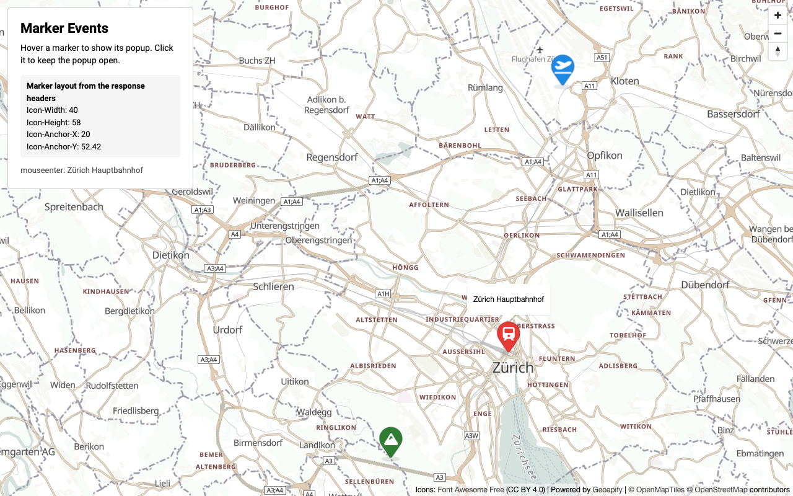

# Custom HTML Markers with Popups and Events on a MapLibre GL Map

Add custom MapLibre GL markers with popups, hover, and click events using pins from the [Geoapify Marker Icon API](https://www.geoapify.com/map-marker-icon-api/). The sample reads each marker's display size and anchor from the response headers, so the pin tip lands exactly on its location.

## Overview

A MapLibre `Marker` is an HTML element. You can style it with CSS and listen to any DOM event, but MapLibre itself emits only drag events for markers, and none of its nine anchor positions is the tip of a pin above a shadow.

How it works:

- Three Zürich places (Zürich Airport, Zürich Hauptbahnhof, Uetliberg) are shown on the `osm-bright-grey` vector style.
- Each marker is an `` with a Font Awesome pin (`type=awesome`, `scaleFactor=2`), sized from `Icon-Width` and `Icon-Height`.
- The marker is anchored at its top-left corner and shifted back by `Icon-Anchor-X` and `Icon-Anchor-Y`.
- Hovering a marker shows its popup, a click pins the popup open, and the panel logs the last event.

## Live Demo

[](https://codepen.io/editor/geoapify/pen/01a1f42c-bd8b-7d8b-a2d9-abbe43430016)

## Screenshot



## Quick Start

Open [`src/index.html`](./src/index.html) in your browser.

No local server is required.

Note: In rare cases, browser policies or extensions can restrict `file://` access. If that happens, run a local static server and open `src/index.html` via `http://localhost`, or use your IDE's "Open with Live Server" (or similar) option.

## Geoapify API Key

This example includes a demo API key for quick preview. For your own projects, create a free Geoapify account and generate an API key in [Geoapify My Projects](https://myprojects.geoapify.com/).

After creating a key:

1. Open [`src/script.js`](./src/script.js).
2. Replace the value of `yourAPIKey` with your API key.
3. Refresh [`src/index.html`](./src/index.html).

## Code Samples

### 1. Load the Marker Image and Its Layout

One `fetch()` returns the image and its `Icon-*` headers. The image is reused through a local blob URL.

```js
async function loadMarker(url) {
  const response = await fetch(url);
  const header = (name) => Number(response.headers.get(name));

  return {
    width: header("Icon-Width"),
    height: header("Icon-Height"),
    anchorX: header("Icon-Anchor-X"),
    anchorY: header("Icon-Anchor-Y"),
    imageUrl: URL.createObjectURL(await response.blob())
  };
}
```

How it works:

- The values are in CSS pixels. For these 52 px pins they are 40 × 58 with the anchor at 20, 52.42.
- The anchor is the pin tip, measured from the top-left corner of the image.

### 2. Add the Marker and Its Popup

The marker's top-left corner is put on the location, then the offset moves the pin tip there instead.

```js
const element = document.createElement("img");
element.src = marker.imageUrl;
element.className = "place-marker";
element.style.width = `${marker.width}px`;
element.style.height = `${marker.height}px`;

const popup = new maplibregl.Popup({
  anchor: "bottom",
  offset: [marker.width / 2 - marker.anchorX, -marker.anchorY],
  closeButton: false
}).setText(place.title);

const mapMarker = new maplibregl.Marker({
  element,
  anchor: "top-left",
  offset: [-marker.anchorX, -marker.anchorY]
})
  .setLngLat([place.lon, place.lat])
  .addTo(map);
```

How it works:

- MapLibre uses `[longitude, latitude]` order.
- The popup offset moves it from the location up to the top of the pin.
- `anchor: "bottom"` keeps the popup above the pin. Without it, MapLibre flips the popup below the location near the top edge of the map, where it covers the marker and catches its clicks.

### 3. Handle Hover and Click Events

The listeners are on the marker element, so every DOM event is available.

```js
let pinned = false;

element.addEventListener("mouseenter", () => {
  if (!popup.isOpen()) {
    popup.setLngLat(mapMarker.getLngLat()).addTo(map);
  }
});

element.addEventListener("mouseleave", () => {
  if (!pinned) {
    popup.remove();
  }
});

element.addEventListener("click", (event) => {
  event.stopPropagation();
  pinned = !pinned;
  popup.setHTML(pinned ? `<strong>${place.title}</strong><br>Pinned. Click again to unpin.` : place.title);
  if (!pinned) {
    popup.remove();
  }
});
```

How it works:

- Hover shows the popup and leaving hides it, unless the marker was clicked.
- `stopPropagation()` keeps the click from reaching the map, so it doesn't trigger map click handlers.
- For a popup that simply toggles on click, use `mapMarker.setPopup(popup)` instead.

## APIs and Libraries

| Name | Description | Documentation | Used In This Example |
|------|-------------|---------------|----------------------|
| [Geoapify Marker Icon API](https://www.geoapify.com/map-marker-icon-api/) | Generates PNG map markers from URL parameters and returns their size and anchor in response headers. | [Docs](https://apidocs.geoapify.com/docs/icon/) | Pin images and the `Icon-*` layout headers. |
| [Geoapify Map Tiles API](https://www.geoapify.com/map-tiles/) | Provides raster and vector map tiles and styles for web maps. | [Docs](https://apidocs.geoapify.com/docs/maps/map-tiles/) | The `osm-bright-grey` vector map style. |
| [MapLibre GL JS](https://maplibre.org/) | Open-source library for interactive vector maps. | [Docs](https://maplibre.org/maplibre-gl-js/docs/) | Renders the map, the HTML markers, and the popups. |
| [Font Awesome Free](https://fontawesome.com/) | Icon set used by `type=awesome` markers. | [License](https://fontawesome.com/license/free) | Pin shape and icons, credited in the map attribution (CC BY 4.0). |

## Related Examples

| Example | Description | Link |
|---------|-------------|------|
| Custom Marker Image in a MapLibre GL Symbol Layer | Draw many points with one marker image as a layer | [Open](https://github.com/geoapify/geoapify-quickstart-examples/tree/main/maps/maplibre-symbol-layer-with-custom-marker-image) |
| Custom Marker Icons with Popups on a Leaflet Map | The same technique in Leaflet | [Open](https://github.com/geoapify/geoapify-quickstart-examples/tree/main/maps/leaflet-custom-marker-icon-with-popup) |
| Marker Shadows and Anchors in MapLibre GL | Compare shadow types and see how they move the anchor | [Open](https://github.com/geoapify/geoapify-quickstart-examples/tree/main/maps/maplibre-marker-icon-api-shadows-and-anchor-headers) |

## Useful Links

- [Geoapify API documentation](https://apidocs.geoapify.com/)
- [Marker Icon API: shadows and map placement](https://apidocs.geoapify.com/docs/icon/#map-placement)
- [Geoapify My Projects: get an API key](https://myprojects.geoapify.com/)
- CodePen demo: [https://codepen.io/editor/geoapify/pen/01a1f42c-bd8b-7d8b-a2d9-abbe43430016](https://codepen.io/editor/geoapify/pen/01a1f42c-bd8b-7d8b-a2d9-abbe43430016)

## License

MIT
