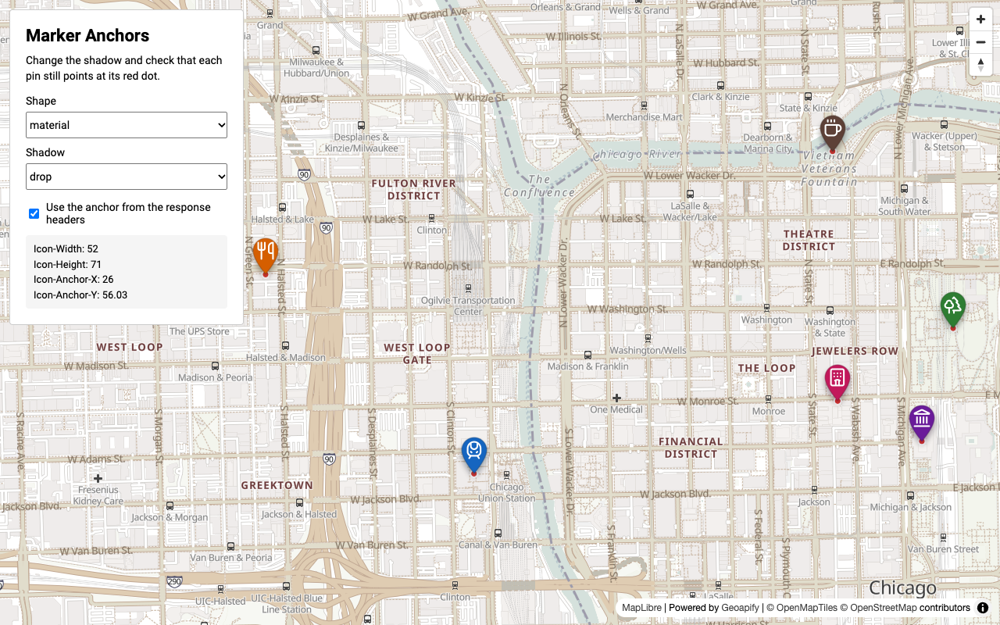

# Marker Shadows and Anchors in MapLibre GL with Geoapify Marker Icon API

Place custom MapLibre GL markers exactly on their coordinates for any shadow style. The [Geoapify Marker Icon API](https://www.geoapify.com/map-marker-icon-api/) returns each marker's display size and anchor point in response headers, and a `HEAD` request returns them without the image.

## Overview

A marker PNG from the Marker Icon API includes its shadow. A drop shadow or a glow makes the image larger and moves the pin tip away from the bottom edge, so a hardcoded "bottom center" anchor puts the marker in the wrong place.

How it works:

- Six places in downtown Chicago are shown with Lucide icons on the `osm-bright-grey` vector style.
- You choose the marker shape (`type`) and the shadow (`shadowType`, or none).
- For each style, the sample sends one `HEAD` request and reads `Icon-Width`, `Icon-Height`, `Icon-Anchor-X`, and `Icon-Anchor-Y`.
- A red dot marks each exact coordinate. Uncheck "Use the anchor from the response headers" to see where a guessed anchor puts the markers.

## Screenshot



## Quick Start

Open [`src/index.html`](./src/index.html) in your browser.

No local server is required.

Note: In rare cases, browser policies or extensions can restrict `file://` access. If that happens, run a local static server and open `src/index.html` via `http://localhost`, or use your IDE's "Open with Live Server" (or similar) option.

## Geoapify API Key

This example includes a demo API key for quick preview. For your own projects, create a free Geoapify account and generate an API key in [Geoapify My Projects](https://myprojects.geoapify.com/).

After creating a key:

1. Open [`src/script.js`](./src/script.js).
2. Replace the value of `yourAPIKey` with your API key.
3. Refresh [`src/index.html`](./src/index.html).

## Code Samples

### 1. Split Style Parameters from Icon Parameters

The marker layout depends on the shape, size, outline, shadow, and `scaleFactor`. The icon and colors change only the picture, so all markers with the same style share one layout.

```js
function getStyleParams(shape, shadow) {
  const params = new URLSearchParams({
    type: shape,
    size: "48",
    contentSize: "20",
    scaleFactor: "2"
  });

  if (shadow === "none") {
    params.set("noShadow", "true");
  } else {
    params.set("shadowType", shadow);
  }

  return params;
}

function getMarkerIconUrl(styleParams, place) {
  const params = new URLSearchParams(styleParams);
  params.set("iconType", "lucide");
  params.set("icon", place.icon);
  params.set("color", place.color);
  params.set("contentColor", "#ffffff");
  params.set("noWhiteCircle", "true");
  params.set("apiKey", yourAPIKey);

  return `https://api.geoapify.com/v2/icon?${params.toString()}`;
}
```

How it works:

- `URLSearchParams` encodes colors, so `#ffffff` is sent as `%23ffffff`.
- `shadowType` (and other shape parameters such as `size` and `strokeWidth`) change the image size and the anchor; `icon` and `color` do not.
- `iconType=lucide` uses [Lucide](https://lucide.dev/icons/) icons on every shape, including the Tabler and Phosphor pins.

### 2. Read the Marker Layout with a HEAD Request

A `HEAD` request with the style parameters returns the `Icon-*` headers without downloading the image. The result is cached per style.

```js
const layoutCache = new Map();

async function getMarkerLayout(styleParams) {
  const key = styleParams.toString();

  if (!layoutCache.has(key)) {
    const response = await fetch(`https://api.geoapify.com/v2/icon?${key}&apiKey=${yourAPIKey}`, { method: "HEAD" });

    layoutCache.set(key, {
      width: Number(response.headers.get("Icon-Width")),
      height: Number(response.headers.get("Icon-Height")),
      anchorX: Number(response.headers.get("Icon-Anchor-X")),
      anchorY: Number(response.headers.get("Icon-Anchor-Y"))
    });
  }

  return layoutCache.get(key);
}
```

How it works:

- The headers are in CSS pixels: the PNG size divided by `scaleFactor`. Values can be fractional, for example `Icon-Width: 50.5`.
- The anchor is the pin tip for pins and the center for `circle` markers, measured from the top-left corner of the image.
- The API exposes these headers through CORS, so browser `fetch()` can read them.

### 3. Place the Marker in MapLibre GL

A MapLibre `Marker` is an HTML element. With `anchor: "top-left"`, the element's top-left corner sits on the coordinate, and a negative offset by the header anchor moves the right pixel onto it.

```js
const image = document.createElement("img");
image.src = getMarkerIconUrl(styleParams, place);
image.style.width = `${layout.width}px`;
image.style.height = `${layout.height}px`;

new maplibregl.Marker({
  element: image,
  anchor: "top-left",
  offset: [-layout.anchorX, -layout.anchorY]
})
  .setLngLat([place.lon, place.lat])
  .addTo(map);
```

How it works:

- The image is displayed at `Icon-Width` × `Icon-Height` CSS pixels; the PNG itself is twice as large because of `scaleFactor=2`.
- `anchor: "top-left"` plus `offset: [-anchorX, -anchorY]` works for every shape. The built-in `"bottom"` anchor only fits pins without a shadow.
- When the style changes, the sample updates `image.src`, the size, and `marker.setOffset()` instead of recreating markers.

## How Much a Shadow Moves the Anchor

`HEAD` responses for a `material` pin with `size=48` (values in CSS pixels):

| Shadow | Icon-Width × Icon-Height | Icon-Anchor-Y | Bottom edge below the tip |
|--------|--------------------------|---------------|---------------------------|
| none (`noShadow`) | 34 × 48 | 48 | 0 |
| `ellipse` (default) | 34 × 52 | 47.44 | 4.56 |
| `floating` | 35 × 62 | 55.85 | 6.15 |
| `drop` | 52 × 71 | 56.42 | 14.58 |
| `glow` | 49 × 62 | 54.92 | 7.08 |

Without the headers, a `drop` marker anchored at the bottom center points to a spot about 15 px above the location.

## APIs and Libraries

| Name | Description | Documentation | Used In This Example |
|------|-------------|---------------|----------------------|
| [Geoapify Marker Icon API](https://www.geoapify.com/map-marker-icon-api/) | Generates PNG map markers from URL parameters and returns their size and anchor in response headers. | [Docs](https://apidocs.geoapify.com/docs/icon/) | Marker images and `HEAD` requests for `Icon-Width`, `Icon-Height`, `Icon-Anchor-X`, and `Icon-Anchor-Y`. |
| [Geoapify Map Tiles API](https://www.geoapify.com/map-tiles/) | Provides raster and vector map tiles for web maps. | [Docs](https://apidocs.geoapify.com/docs/maps/map-tiles/) | Base map with the `osm-bright-grey` vector style. |
| [MapLibre GL](https://maplibre.org/) | JavaScript library for interactive web maps. | [Docs](https://maplibre.org/maplibre-gl-js/docs/) | Renders the vector map, the red location dots as a circle layer, and the markers as HTML elements. |

## Related Examples

| Example | Description | Link |
|---------|-------------|------|
| Marker Shadows and Anchors in Leaflet | The same demo in Leaflet | [Open](https://github.com/geoapify/geoapify-quickstart-examples/tree/main/maps/leaflet-marker-icon-api-shadows-and-anchor-headers) |
| Marker Shadows and Anchors in OpenLayers | The same demo in OpenLayers | [Open](https://github.com/geoapify/geoapify-quickstart-examples/tree/main/maps/openlayers-marker-icon-api-shadows-and-anchor-headers) |
| MapLibre Custom Markers and Popups | Rich place details in MapLibre popups | [Open](https://github.com/geoapify/geoapify-quickstart-examples/tree/main/maps/maplibre-custom-markers-popups-with-geoapify-place-details) |
| MapLibre Map Tiles Starter | Basic MapLibre GL map with Geoapify tiles | [Open](https://github.com/geoapify/geoapify-quickstart-examples/tree/main/maps/maplibre-geoapify-map-tiles-starter) |

## Useful Links

- [Geoapify API documentation](https://apidocs.geoapify.com/)
- [How to Add Markers to a Map](https://apidocs.geoapify.com/how-to/maps/add-map-markers/)
- [Geoapify My Projects: get an API key](https://myprojects.geoapify.com/)

## License

MIT
