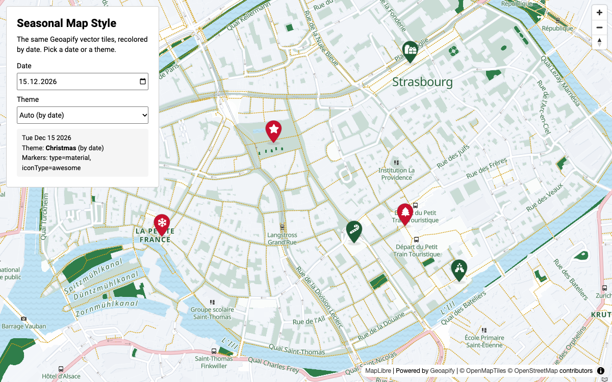

# Seasonal Map Style by Date in MapLibre GL with Geoapify Vector Tiles

Make a Christmas, Halloween, or other seasonal map style without a second style file. This MapLibre GL example recolors the [Geoapify](https://www.geoapify.com/map-tiles/) `osm-bright` vector style with `setPaintProperty`, switches the theme automatically by date, and swaps the markers for seasonal icons from the [Geoapify Marker Icon API](https://www.geoapify.com/map-marker-icon-api/).

## Overview

A seasonal style is the same vector tiles with different colors. The tiles, labels, and data stay the same; only the paint properties of the style layers change, so there is nothing extra to host or switch on the server.

How it works:

- Six squares in central Strasbourg are shown on the `osm-bright` vector style.
- "Auto (by date)" picks the theme from the date: Christmas (Dec 1 – Jan 6), Winter, Valentine's Day, St. Patrick's Day, Easter (Palm Sunday to Easter Monday), Summer, Autumn, and Halloween (Oct 24 – 31).
- Change the date to preview another season, or choose a theme directly.
- Force a theme regardless of the date with `?theme=halloween` in the page URL or the `forcedTheme` setting in `script.js`.
- Each theme sets one color per layer group (water, parks, roads, labels, and so on) and its own marker shape and icons. Every theme uses a different Marker Icon API `type`, so the example shows all marker shapes.
- Before a theme is applied, the original paint values are restored, so themes never mix.

## Live Demo

[](https://codepen.io/editor/geoapify/pen/01a1a725-6566-77e7-b042-2db92ea5e3cc)

## Screenshot



## Quick Start

Open [`src/index.html`](./src/index.html) in your browser.

No local server is required.

Note: In rare cases, browser policies or extensions can restrict `file://` access. If that happens, run a local static server and open `src/index.html` via `http://localhost`, or use your IDE's "Open with Live Server" (or similar) option.

## Geoapify API Key

This example includes a demo API key for quick preview. For your own projects, create a free Geoapify account and generate an API key in [Geoapify My Projects](https://myprojects.geoapify.com/).

After creating a key:

1. Open [`src/script.js`](./src/script.js).
2. Replace the value of `yourAPIKey` with your API key.
3. Refresh [`src/index.html`](./src/index.html).

## Code Samples

### 1. Group the Style Layers

The `osm-bright` style has more than 100 layers. A theme does not need a color for each one: layers that draw the same kind of feature are grouped, and a palette sets one color per group.

```js
const layerGroups = {
  background: [["background", "background-color"]],
  park: ["park", "landcover-grass", "landcover-grass-park"].map((id) => [id, "fill-color"]),
  water: [["water", "fill-color"], ["waterway-river", "line-color"]],
  roadMajor: ["highway-primary", "highway-trunk", "highway-motorway"].map((id) => [id, "line-color"]),
  path: ["highway-path", "bridge-path", "tunnel-path"].map((id) => [id, "line-color"]),
  label: ["place-city", "highway-name-minor", "highway-name-major"].map((id) => [id, "text-color"])
};

const christmasPalette = {
  background: "#fbfcff",
  park: "#2f7d4a",
  water: "#bfe3f5",
  roadMajor: "#e8a0aa",
  path: "#d4a017",
  label: "#1e5a35"
};
```

How it works:

- Each entry is a `[layer id, paint property]` pair. Fill layers use `fill-color`, line layers `line-color`, and label layers `text-color` and `text-halo-color`.
- The layer ids come from the style JSON: `https://maps.geoapify.com/v1/styles/osm-bright/style.json`. The full example covers buildings, land use, casings, minor roads, railways, and labels too.
- Find a layer id by clicking the map in the [Maps playground](https://apidocs.geoapify.com/playground/maps/): its layer editor lists the layers under the cursor and generates the `setPaintProperty` code for the colors you pick.

### 2. Apply a Palette and Restore the Original Style

The original paint values are saved once after the style loads. Every theme change restores them first and then applies the new palette.

```js
const originalPaint = [];

map.on("load", () => {
  Object.values(layerGroups).flat().forEach(([layerId, property]) => {
    if (map.getLayer(layerId)) {
      originalPaint.push([layerId, property, map.getPaintProperty(layerId, property)]);
    }
  });
});

function applyPalette(palette) {
  originalPaint.forEach(([layerId, property, value]) => map.setPaintProperty(layerId, property, value));

  Object.entries(palette).forEach(([group, color]) => {
    layerGroups[group].forEach(([layerId, property]) => {
      if (map.getLayer(layerId)) {
        map.setPaintProperty(layerId, property, color);
      }
    });
  });
}
```

How it works:

- `setPaintProperty` changes a layer on the client. No tiles are downloaded again.
- Many original values are zoom expressions, not plain colors. Saving them with `getPaintProperty` restores the exact default style, including the zoom-dependent widths and colors.
- An empty palette (`{}`) brings back the default `osm-bright` look.

### 3. Pick the Theme by Date

Fixed holidays are month-day ranges; a range can cross the new year. Easter moves, so it is calculated for each year. Holidays are checked before the longer seasons, so Valentine's Day wins over Winter.

```js
const seasonRules = [
  { theme: "christmas", from: [12, 1], to: [1, 6] },
  { theme: "valentine", from: [2, 7], to: [2, 14] },
  { theme: "easter", easter: true },
  { theme: "halloween", from: [10, 24], to: [10, 31] },
  { theme: "winter", from: [1, 7], to: [2, 29] },
  { theme: "autumn", from: [9, 22], to: [11, 30] }
];

function matchesRule(rule, date) {
  if (rule.easter) {
    const easter = getEasterSunday(date.getFullYear());
    const from = new Date(easter.getFullYear(), easter.getMonth(), easter.getDate() - 7);
    const to = new Date(easter.getFullYear(), easter.getMonth(), easter.getDate() + 1);
    return date >= from && date <= to;
  }

  const value = (date.getMonth() + 1) * 100 + date.getDate();
  const from = rule.from[0] * 100 + rule.from[1];
  const to = rule.to[0] * 100 + rule.to[1];

  return from <= to ? value >= from && value <= to : value >= from || value <= to;
}

function getThemeForDate(date) {
  const rule = seasonRules.find((item) => matchesRule(item, date));
  return rule ? rule.theme : "default";
}
```

How it works:

- A date becomes a number like `1215` for December 15, so ranges compare as numbers. When `from` is greater than `to`, the range crosses the new year.
- `getEasterSunday()` uses the Anonymous Gregorian algorithm: Easter Sunday is April 5 in 2026 and March 28 in 2027.
- The date is the visitor's local date. Use a fixed time zone instead if all visitors should switch at the same moment.

### 4. Force a Particular Theme

Sometimes the theme should not follow the calendar: a campaign starts early, or you want to preview Christmas in November. A URL parameter or a setting in the code overrides the date.

```js
const forcedTheme = null; // for example "christmas"

const requestedTheme = new URLSearchParams(window.location.search).get("theme") || forcedTheme;

if (requestedTheme && themes[requestedTheme]) {
  document.getElementById("theme-select").value = requestedTheme;
}
```

How it works:

- `?theme=halloween` in the page URL wins over `forcedTheme`; with neither, the theme is picked by date.
- Only known theme ids are accepted (`default`, `christmas`, `winter`, `valentine`, `stpatrick`, `easter`, `summer`, `autumn`, `halloween`). An unknown value keeps the automatic choice.
- The status box shows "forced" or "by date", so you can see which rule picked the theme.

### 5. Switch the Markers with the Theme

Each theme has one set of Marker Icon API parameters (shape, size, shadow) and one icon per place. A `HEAD` request returns the marker size and anchor for the whole theme.

```js
const christmas = {
  marker: { type: "material", iconType: "awesome", size: "46", contentSize: "18" },
  icons: ["tree", "gifts", "star", "candy-cane", "snowflake", "holly-berry"],
  colors: ["#c8102e", "#1e5a35"]
};

function getMarkerIconUrl(theme, index) {
  const params = new URLSearchParams(theme.marker);
  params.set("icon", theme.icons[index]);
  params.set("color", theme.colors[index % theme.colors.length]);
  params.set("contentColor", "#ffffff");
  params.set("noWhiteCircle", "true");
  params.set("scaleFactor", "2");
  params.set("apiKey", yourAPIKey);

  return `https://api.geoapify.com/v2/icon?${params.toString()}`;
}
```

How it works:

- `iconType` picks the icon library separately from the shape, so Font Awesome icons can sit on a Material pin.
- `noWhiteCircle` removes the white circle behind the icon, and `contentColor=#ffffff` draws the icon in white right on the theme color.
- Wide icons need a smaller `contentSize`: the Christmas `gifts` icon fits a 46 px pin at `contentSize=18`.
- The Halloween theme uses `type=circle`, `iconType=mdi`, and `shadowType=glow` for glowing markers on a dark map.
- Markers are placed with the `Icon-Anchor-X` and `Icon-Anchor-Y` headers, as in the [MapLibre marker anchors example](https://github.com/geoapify/geoapify-quickstart-examples/tree/main/maps/maplibre-marker-icon-api-shadows-and-anchor-headers).

## Themes and Marker Types

| Theme | Dates (Auto) | Marker `type` | Icon library | Icons |
|-------|--------------|---------------|--------------|-------|
| Christmas | Dec 1 – Jan 6 | `material` | Font Awesome (`iconType=awesome`) | tree, gifts, star, candy-cane, snowflake, holly-berry |
| Winter | Jan 7 – end of Feb | `circle` | Material Icons | ac_unit, downhill_skiing, ice_skating, sledding, snowboarding, local_fire_department |
| Valentine's Day | Feb 7 – 14 | `awesome` | Font Awesome | heart, gem, champagne-glasses, cake-candles, wine-glass, heart-circle-check |
| St. Patrick's Day | Mar 14 – 17 | `tabler` | Tabler Icons | clover, clover-2, glass-full, rainbow, sparkles, bottle |
| Easter | Palm Sunday – Easter Monday | `phosphor` | Phosphor Icons | egg, flower-tulip, butterfly, flower, bird, plant |
| Summer | Jun 21 – Aug 31 | `material-symbols-rounded` | Material Symbols Rounded | sunny, beach_access, icecream, celebration, local_florist, cake |
| Autumn | Sep 22 – Nov 30 | `lucide` | Lucide | leaf, wheat, apple, cookie, trees, sprout |
| Halloween | Oct 24 – 31 | `circle` | Material Design Icons (`iconType=mdi`) | halloween, ghost, skull, bat, spider, candle |

Check the [icon attribution requirements](https://apidocs.geoapify.com/docs/icon/#attribution) of the icon libraries you use.

## APIs and Libraries

| Name | Description | Documentation | Used In This Example |
|------|-------------|---------------|----------------------|
| [Geoapify Map Tiles API](https://www.geoapify.com/map-tiles/) | Provides raster and vector map tiles and ready-made map styles. | [Docs](https://apidocs.geoapify.com/docs/maps/map-tiles/) | `osm-bright` vector style, recolored for each season. |
| [Geoapify Marker Icon API](https://www.geoapify.com/map-marker-icon-api/) | Generates PNG map markers from URL parameters and returns their size and anchor in response headers. | [Docs](https://apidocs.geoapify.com/docs/icon/) | Seasonal markers in every shape, and `HEAD` requests for the marker anchor. |
| [MapLibre GL](https://maplibre.org/) | JavaScript library for interactive vector maps. | [Docs](https://maplibre.org/maplibre-gl-js/docs/) | Renders the map; `getPaintProperty` and `setPaintProperty` change the colors. |

## Related Examples

| Example | Description | Link |
|---------|-------------|------|
| MapLibre Vector Map Localization | Switch map styles and label languages | [Open](https://github.com/geoapify/geoapify-quickstart-examples/tree/main/maps/maplibre-vector-map-localization) |
| Marker Shadows and Anchors in MapLibre GL | Place markers exactly with the Icon-Anchor headers | [Open](https://github.com/geoapify/geoapify-quickstart-examples/tree/main/maps/maplibre-marker-icon-api-shadows-and-anchor-headers) |
| MapLibre Map Tiles Starter | Basic MapLibre GL map with Geoapify tiles | [Open](https://github.com/geoapify/geoapify-quickstart-examples/tree/main/maps/maplibre-geoapify-map-tiles-starter) |

## Useful Links

- [Geoapify API documentation](https://apidocs.geoapify.com/)
- [How to change and customize a map style](https://apidocs.geoapify.com/how-to/maps/change-map-style/)
- [Maps playground](https://apidocs.geoapify.com/playground/maps/)
- [Geoapify My Projects: get an API key](https://myprojects.geoapify.com/)
- CodePen demo: [https://codepen.io/editor/geoapify/pen/01a1a725-6566-77e7-b042-2db92ea5e3cc](https://codepen.io/editor/geoapify/pen/01a1a725-6566-77e7-b042-2db92ea5e3cc)

## License

MIT
