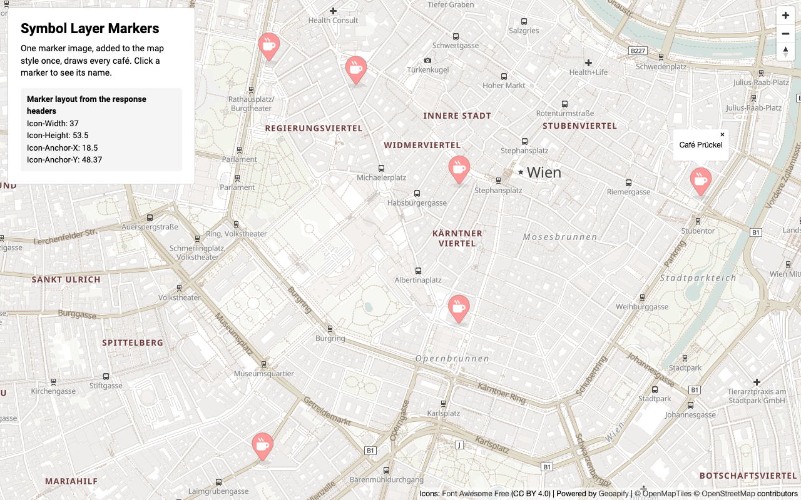

# Custom Marker Image in a MapLibre GL Symbol Layer

Draw many points on a MapLibre GL map with one custom marker image from the [Geoapify Marker Icon API](https://www.geoapify.com/map-marker-icon-api/). The image is added to the map style once and used by a `symbol` layer, anchored with the size and anchor from the response headers.

## Overview

For many points, a symbol layer is faster than separate HTML markers, and one image serves every point. The layer still needs the right anchor: a Marker Icon API image includes a shadow, so the pin tip is not at the bottom edge.

How it works:

- Six Vienna coffee houses are shown as GeoJSON points on the `osm-bright-grey` vector style.
- The sample requests one Font Awesome pin (`type=awesome`, `icon=mug-hot`, `scaleFactor=2`) with `fetch()` and reads its `Icon-*` headers.
- `map.addImage()` adds the image to the style with `pixelRatio` equal to `scaleFactor`.
- The layer anchors the image at its top-left corner and shifts it by the anchor from the headers. A click on a marker opens a popup with the café's name.

## Live Demo

[](https://codepen.io/editor/geoapify/pen/01a1f42c-d350-7dbd-803b-65362a92c5a2)

## Screenshot



## Quick Start

Open [`src/index.html`](./src/index.html) in your browser.

No local server is required.

Note: In rare cases, browser policies or extensions can restrict `file://` access. If that happens, run a local static server and open `src/index.html` via `http://localhost`, or use your IDE's "Open with Live Server" (or similar) option.

## Geoapify API Key

This example includes a demo API key for quick preview. For your own projects, create a free Geoapify account and generate an API key in [Geoapify My Projects](https://myprojects.geoapify.com/).

After creating a key:

1. Open [`src/script.js`](./src/script.js).
2. Replace the value of `yourAPIKey` with your API key.
3. Refresh [`src/index.html`](./src/index.html).

## Code Samples

### 1. Load the Marker Image and Its Layout

One `fetch()` returns the image and its `Icon-*` headers. The image is passed on through a local blob URL.

```js
async function loadMarker(url) {
  const response = await fetch(url);
  const header = (name) => Number(response.headers.get(name));

  return {
    width: header("Icon-Width"),
    height: header("Icon-Height"),
    anchorX: header("Icon-Anchor-X"),
    anchorY: header("Icon-Anchor-Y"),
    imageUrl: URL.createObjectURL(await response.blob())
  };
}
```

How it works:

- The values are in CSS pixels. For this 48 px pin they are 37 × 53.5 with the anchor at 18.5, 48.37.
- The anchor is the pin tip, measured from the top-left corner of the image.

### 2. Add the Image to the Map Style

The image is loaded once, when the style is ready.

```js
map.on("load", async () => {
  const marker = await loadMarker(markerUrl);
  const image = await map.loadImage(marker.imageUrl);

  map.addImage("cafe-marker", image.data, { pixelRatio: SCALE_FACTOR });
  // ... source and layer
});
```

How it works:

- `pixelRatio` must equal the `scaleFactor` of the marker URL, so the double-resolution PNG is drawn at its display size.
- Any layer of the style can now use the image by its name, `cafe-marker`.

### 3. Draw the Points as a Symbol Layer

The named `icon-anchor` positions don't include the pin tip above a shadow, so the layer uses the top-left corner and an offset.

```js
map.addSource("cafes", { type: "geojson", data: cafes });

map.addLayer({
  id: "cafes",
  type: "symbol",
  source: "cafes",
  layout: {
    "icon-image": "cafe-marker",
    "icon-anchor": "top-left",
    "icon-offset": [-marker.anchorX, -marker.anchorY],
    "icon-allow-overlap": true
  }
});

map.on("click", "cafes", (event) => {
  const feature = event.features[0];

  new maplibregl.Popup({ anchor: "bottom", offset: [marker.width / 2 - marker.anchorX, -marker.anchorY] })
    .setLngLat(feature.geometry.coordinates)
    .setText(feature.properties.name)
    .addTo(map);
});
```

How it works:

- `icon-offset` moves the image so the pin tip, not its top-left corner, lands on each point.
- `icon-allow-overlap` keeps every marker visible when points are close.
- Layer events (`click`, `mouseenter`, `mouseleave`) give the clicked feature and its properties.

## APIs and Libraries

| Name | Description | Documentation | Used In This Example |
|------|-------------|---------------|----------------------|
| [Geoapify Marker Icon API](https://www.geoapify.com/map-marker-icon-api/) | Generates PNG map markers from URL parameters and returns their size and anchor in response headers. | [Docs](https://apidocs.geoapify.com/docs/icon/) | The pin image and its `Icon-*` layout headers. |
| [Geoapify Map Tiles API](https://www.geoapify.com/map-tiles/) | Provides raster and vector map tiles and styles for web maps. | [Docs](https://apidocs.geoapify.com/docs/maps/map-tiles/) | The `osm-bright-grey` vector map style. |
| [MapLibre GL JS](https://maplibre.org/) | Open-source library for interactive vector maps. | [Docs](https://maplibre.org/maplibre-gl-js/docs/) | Renders the map, the symbol layer, and the popups. |
| [Font Awesome Free](https://fontawesome.com/) | Icon set used by `type=awesome` markers. | [License](https://fontawesome.com/license/free) | Pin shape and icon, credited in the map attribution (CC BY 4.0). |

## Related Examples

| Example | Description | Link |
|---------|-------------|------|
| Custom HTML Markers with Popups and Events in MapLibre GL | Separate HTML markers with hover and click events | [Open](https://github.com/geoapify/geoapify-quickstart-examples/tree/main/maps/maplibre-custom-html-markers-popups-and-events) |
| Custom Marker Icons with Popups on a Leaflet Map | Marker Icon API pins in Leaflet | [Open](https://github.com/geoapify/geoapify-quickstart-examples/tree/main/maps/leaflet-custom-marker-icon-with-popup) |
| Marker Shadows and Anchors in MapLibre GL | Compare shadow types and see how they move the anchor | [Open](https://github.com/geoapify/geoapify-quickstart-examples/tree/main/maps/maplibre-marker-icon-api-shadows-and-anchor-headers) |

## Useful Links

- [Geoapify API documentation](https://apidocs.geoapify.com/)
- [Marker Icon API: shadows and map placement](https://apidocs.geoapify.com/docs/icon/#map-placement)
- [Geoapify My Projects: get an API key](https://myprojects.geoapify.com/)
- CodePen demo: [https://codepen.io/editor/geoapify/pen/01a1f42c-d350-7dbd-803b-65362a92c5a2](https://codepen.io/editor/geoapify/pen/01a1f42c-d350-7dbd-803b-65362a92c5a2)

## License

MIT
