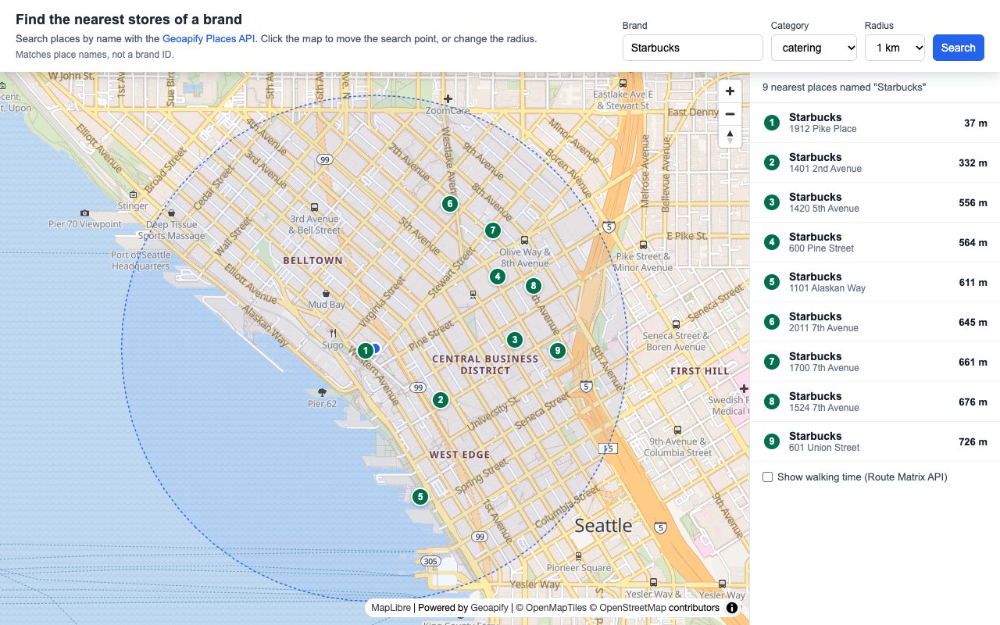

# Find the Nearest Stores of a Brand on a MapLibre Map with Geoapify Places API Name Search

Find the nearest stores of a brand, such as the nearest Starbucks, with the `name` parameter of the [Geoapify Places API](https://www.geoapify.com/places-api/) and show them on a [MapLibre](https://maplibre.org/) map. Choose a search radius, click the map to move the search point, see numbered store markers and a list sorted by distance, and optionally replace straight-line distances with walking times from the [Geoapify Route Matrix API](https://www.geoapify.com/route-matrix-api/).

## Overview

This example shows how to search places by name inside a circle around a point and rank them by distance.

The Places API has no brand filter. The `name` parameter matches place names, so the sample finds places whose name matches the text you enter (for example, `Starbucks`), not places linked to a brand ID.

How it works:

- The map starts at Pike Place Market in Seattle and searches for `Starbucks` in the `catering` category within 1 km.
- The search form lets you change the brand name, the category (`catering` or `commercial`), and the radius (500 m, 1 km or 2 km).
- The search area is drawn on the map as a dashed circle, and the map is fitted to the circle on every search.
- The Places API request combines `name`, `categories`, `filter=circle`, `bias=proximity` and `limit=10`, so up to 10 of the nearest matching places are returned.
- Each place gets a numbered marker on the map and a row in the list with its name, street address, and straight-line distance from the search point.
- Click a list row to fly the map to that place. Click the map to move the search point and search again.
- A checkbox at the bottom of the list, unchecked by default and hidden while there are no results, calls the Route Matrix API in walking mode and replaces each distance with a walking icon, the walking time, and the walking distance.

## Live Demo

[](https://codepen.io/editor/geoapify/pen/01a1c4f9-76ba-752a-806c-d070e041e359)

## Screenshot



## Quick Start

Open [`src/index.html`](./src/index.html) in your browser.

No local server is required.

Note: In rare cases, browser policies or extensions can restrict `file://` access. If that happens, run a local static server and open [`src/index.html`](./src/index.html) via `http://localhost`, or use your IDE's "Open with Live Server" option.

## Geoapify API Key

This example includes a demo API key for quick preview. For your own projects, create a free Geoapify API key in [Geoapify My Projects](https://myprojects.geoapify.com/). No credit card is required.

After creating a key:

1. Open [`src/script.js`](./src/script.js).
2. Replace the value of `apiKey` with your API key.
3. Refresh [`src/index.html`](./src/index.html).

Using your own key gives you access to project settings, usage statistics, and production-ready request limits.

## Code Samples

### 1. Initialize a MapLibre Map with Geoapify Tiles

This code creates a MapLibre map centered on the initial search point and loads a Geoapify vector map style.

```js
const apiKey = "YOUR_API_KEY";

// Pike Place Market, Seattle
const initialSearchPoint = [-122.3421, 47.6101];

const map = new maplibregl.Map({
  container: "map",
  style: `https://maps.geoapify.com/v1/styles/osm-bright/style.json?apiKey=${apiKey}`,
  center: initialSearchPoint,
  zoom: 14
});

map.addControl(new maplibregl.NavigationControl(), "top-right");
```

How it works:

- `container: "map"` connects MapLibre to the `<div id="map">` element in [`src/index.html`](./src/index.html).
- The `style` URL loads Geoapify vector map tiles with the `osm-bright` style.
- `center` uses `[longitude, latitude]` order, the same order the Places API and Route Matrix API use.
- `NavigationControl` adds zoom and rotation buttons.

### 2. Search Places by Name with the Geoapify Places API

This is the main request of the sample. It searches places whose name matches the entered brand inside a circle around the search point and returns the nearest ones first.

```js
const [lon, lat] = searchPoint;

// The Places API has no brand filter: `name` matches place names.
const params = new URLSearchParams({
  categories: categorySelect.value,
  name: brandName,
  filter: `circle:${lon},${lat},${searchRadiusMeters}`,
  bias: `proximity:${lon},${lat}`,
  limit: 10,
  apiKey: apiKey
});

fetch(`https://api.geoapify.com/v2/places?${params}`)
  .then(response => response.json())
  .then(placesData => {
    showStores(placesData.features || [], brandName, searchRadiusMeters);
  });
```

How it works:

- `name` returns places matching the given name, for example `name=Starbucks`. It is a place-name match, not a brand filter.
- `categories` narrows the search to a category group: `catering` for coffee shops and restaurants, or `commercial` for shops.
- `filter=circle:lon,lat,radius` keeps results inside the selected radius in meters.
- `bias=proximity:lon,lat` orders results by distance from the search point, so the first results are the nearest.
- `limit=10` returns at most 10 places.
- `URLSearchParams` encodes the brand name and the other values for the URL.

### 3. Draw the Search Circle and Fit the Map to It

The search area is a GeoJSON polygon drawn as a light fill with a dashed outline. Every search updates the circle and fits the map to it, so the whole search area stays visible.

```js
map.addSource("search-area", {
  type: "geojson",
  data: createCircle(searchPoint, Number(radiusSelect.value))
});

map.addLayer({
  id: "search-area-line",
  type: "line",
  source: "search-area",
  paint: {
    "line-color": "#2563eb",
    "line-width": 1.5,
    "line-dasharray": [2, 2]
  }
});

function fitMapToCircle(circle) {
  const bounds = new maplibregl.LngLatBounds(searchPoint, searchPoint);
  circle.geometry.coordinates[0].forEach(point => bounds.extend(point));

  map.fitBounds(bounds, { padding: 30, duration: 500 });
}
```

How it works:

- `createCircle()` in [`src/script.js`](./src/script.js) builds an approximate circle polygon with 64 points from the center and the radius in meters.
- The `search-area` GeoJSON source holds the circle; a fill layer and a dashed line layer render it.
- On each search, `map.getSource("search-area").setData()` replaces the circle with the new center or radius.
- `fitMapToCircle()` extends `LngLatBounds` with every circle point and calls `fitBounds()`.

### 4. Show Numbered Markers and the Result List

Each returned place gets a numbered MapLibre marker and a matching list row with its name, street address, and straight-line distance.

```js
stores.forEach((store, index) => {
  const number = index + 1;
  const properties = store.properties;
  const coordinates = store.geometry.coordinates;

  const markerElement = document.createElement("div");
  markerElement.className = "store-marker";
  markerElement.textContent = number;

  new maplibregl.Marker({ element: markerElement, anchor: "center" })
    .setLngLat(coordinates)
    .addTo(map);

  const distance = document.createElement("span");
  distance.className = "results__distance";
  // Straight-line distance from the Places API, kept to restore it
  distance.dataset.straight = `${Math.round(properties.distance)} m`;
  distance.textContent = distance.dataset.straight;

  listItem.addEventListener("click", () => {
    map.flyTo({ center: coordinates, zoom: 17 });
  });
});
```

How it works:

- The marker number follows the order of the response, which is sorted by distance because of `bias=proximity`.
- `properties.distance` is the distance in meters to the biased location, which is the search point here.
- The straight-line distance is saved in `dataset.straight` so it can be restored when the walking-time checkbox is turned off.
- The list row shows `housenumber` and `street` when available, otherwise `address_line2` or `formatted`.
- Clicking a row calls `flyTo()` to zoom to that place.

### 5. Move the Search Point on Map Click

A click on the map moves the search point and runs the search again. Clicks on markers are ignored.

```js
map.on("click", event => {
  if (event.originalEvent.target.closest(".maplibregl-marker")) {
    return;
  }

  searchPoint = [event.lngLat.lng, event.lngLat.lat];
  searchPointMarker.setLngLat(searchPoint);
  findNearestStores();
});
```

How it works:

- `event.lngLat` gives the clicked coordinates.
- The blue search point marker moves with `setLngLat()` before the new search.
- Changing the radius also calls `findNearestStores()`, so the circle and the results update right away.
- Each search gets a request ID, and responses from older searches are ignored.

### 6. Get Walking Times with the Route Matrix API

When the checkbox is on, the sample sends one Route Matrix API request with the search point as the only source and the found places as targets, then shows a walking time and distance for each place.

```js
fetch(`https://api.geoapify.com/v1/routematrix?apiKey=${apiKey}`, {
  method: "POST",
  headers: { "Content-Type": "application/json" },
  body: JSON.stringify({
    mode: "walk",
    sources: [{ location: searchPoint }],
    targets: currentStores.map(store => ({ location: store.geometry.coordinates }))
  })
})
  .then(response => response.json())
  .then(matrixData => {
    matrixData.sources_to_targets[0].forEach(cell => {
      distanceElements[cell.target_index].replaceChildren(
        createWalkIcon(),
        `${formatTime(cell.time)} · ${formatDistance(cell.distance)}`
      );
    });
  });
```

How it works:

- `mode: "walk"` calculates walking routes.
- `sources_to_targets` has one row per source. With one source, row `0` holds one cell per place.
- Each cell has `time` in seconds, `distance` in meters, and `target_index`, which points back to the place in the list.
- The matrix cost is `max(sources, targets) × min(sources, targets, 10)` credits, so 1 source and 10 places cost 10 credits per request. That is why the checkbox is off by default. See the [Route Matrix API docs](https://apidocs.geoapify.com/docs/route-matrix/) for the full pricing rules.
- Unchecking the box restores the straight-line distances without a new request.
- The walking icon is the Material Icons "directions_walk" icon by Google, used under the Apache License 2.0.

## Troubleshooting

| Problem | What to Check |
| --- | --- |
| Map is not visible | Check that the MapLibre GL JS library and CSS are loaded, the `#map` element has height, and the Geoapify API key is correct. |
| Map tiles do not load | Inspect the browser network tab for failed `maps.geoapify.com` requests. Verify that the API key is valid. |
| No places are found | Check the spelling of the name, try another category (`catering` or `commercial`), increase the radius, or click a different map location. |
| A store of the brand is missing | `name` matches place names, not a brand ID. A store outside the selected category is not returned, and a store whose place name is spelled differently may not match. Try another spelling or category. |
| The walking-time checkbox is missing | The checkbox is hidden while there are no results. Run a search that returns places. |
| Walking times do not appear | Check the `api.geoapify.com/v1/routematrix` request in the network tab and confirm the API key can use the Route Matrix API. |
| Markers appear in the wrong place | Confirm that coordinates are passed as `[longitude, latitude]`. |
| Output differs from expected | Compare your files with the [CodePen demo](https://codepen.io/editor/geoapify/pen/01a1c4f9-76ba-752a-806c-d070e041e359) and align differences step by step. |

## APIs and Libraries

| Name | Description | Documentation | Used In This Example |
| --- | --- | --- | --- |
| Geoapify Places API | Searches places by category, name, area, and proximity and returns GeoJSON features. | [Places API docs](https://apidocs.geoapify.com/docs/places/) | Finds up to 10 of the nearest places matching the entered name within the selected radius. |
| Geoapify Route Matrix API | Calculates travel times and distances between sets of sources and targets. | [Route Matrix API docs](https://apidocs.geoapify.com/docs/route-matrix/) | Optional: walking time and walking distance from the search point to each place. |
| Geoapify Map Tiles | Provides the vector map style used by MapLibre GL JS. | [Map Tiles docs](https://apidocs.geoapify.com/docs/maps/) | Loads the `osm-bright` map style from `maps.geoapify.com`. |
| MapLibre GL JS | Open-source JavaScript library for interactive vector maps in the browser. | [MapLibre GL JS docs](https://maplibre.org/maplibre-gl-js/docs/) | Renders the map, the search circle, numbered markers, click handling, and map fitting. |
| Material Icons | Google's icon set, licensed under the Apache License 2.0. | [Material Icons](https://fonts.google.com/icons) | The "directions_walk" icon next to walking times, inlined as SVG. |

## Related Examples

| Example | Description | Link |
| --- | --- | --- |
| Nearest Restaurants with Type Markers | MapLibre click-to-search for the 20 nearest restaurants with cuisine-based markers. | [Open](https://github.com/geoapify/geoapify-quickstart-examples/tree/main/places-api/maplibre-nearest-restaurants-with-type-markers) |
| Places API with Dynamic Markers | Leaflet category search with custom Geoapify marker icons. | [Open](https://github.com/geoapify/geoapify-quickstart-examples/tree/main/places-api/leaflet-demo-geoapify-places-api-category-search-with-dynamic-markers) |
| Calculate Driving Distance Matrix | Driving distances and travel times between multiple locations with the Route Matrix API. | [Open](https://github.com/geoapify/geoapify-quickstart-examples/tree/main/matrix-api/calculate-driving-distance-matrix-api) |
| MapLibre Map Tiles Starter | Minimal MapLibre GL JS setup with Geoapify vector map tiles. | [Open](https://github.com/geoapify/geoapify-quickstart-examples/tree/main/maps/maplibre-geoapify-map-tiles-starter) |

## Useful Links

- [Geoapify](https://www.geoapify.com/) - learn more about Geoapify APIs and location services
- [Geoapify Places API](https://www.geoapify.com/places-api/)
- [Geoapify Route Matrix API](https://www.geoapify.com/route-matrix-api/)
- [Geoapify Pricing](https://www.geoapify.com/pricing/)
- [Geoapify API Playground](https://apidocs.geoapify.com/playground/)
- [Geoapify My Projects](https://myprojects.geoapify.com/) - create and manage API keys
- CodePen demo: [https://codepen.io/editor/geoapify/pen/01a1c4f9-76ba-752a-806c-d070e041e359](https://codepen.io/editor/geoapify/pen/01a1c4f9-76ba-752a-806c-d070e041e359)
- [MapLibre Project](https://maplibre.org/)
- [Geoapify Quickstart Examples](https://github.com/geoapify/geoapify-quickstart-examples)

## License

MIT
