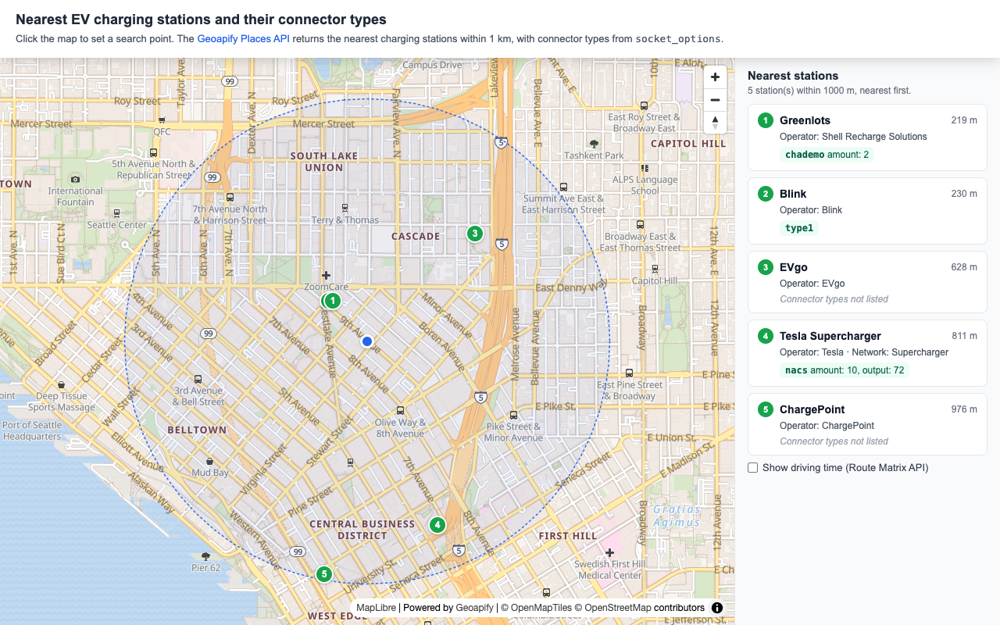

# Find the Nearest EV Charging Stations and Connector Types with Geoapify Places API and MapLibre

Build an interactive [MapLibre](https://maplibre.org/) EV charging station finder that searches the nearest charging stations with the [Geoapify Places API](https://www.geoapify.com/places-api/) and lists each station's operator, network, and connector types. Click any point on the map to move the search point, and optionally switch the straight-line distances to driving time and driving distance from the [Geoapify Route Matrix API](https://www.geoapify.com/route-matrix-api/).

## Overview

This example shows how to combine [MapLibre GL JS](https://maplibre.org/maplibre-gl-js/docs/) with Geoapify APIs to find EV charging stations near a point and show which connectors they offer.

How it works:

- The map starts in the Denny Triangle in downtown Seattle and shows the search point as a blue dot with a dashed 1 km search circle.
- When a user clicks the map, the search point and circle move to the clicked coordinates.
- The app requests up to 20 charging stations within 1 km using the [Geoapify Places API](https://www.geoapify.com/places-api/) with the `service.vehicle.charging_station` category.
- Stations are shown as numbered markers on the map and as a numbered list, nearest first, with their straight-line distance from the search point.
- Each station shows its operator and network, and the connector types from `socket_options`, the property the API returns for charging stations. Some stations have no connector types listed.
- Clicking a list item centers the map on the station and opens its popup.
- A checkbox at the bottom of the list (off by default) calls the [Geoapify Route Matrix API](https://www.geoapify.com/route-matrix-api/) and replaces each straight-line distance with driving time and driving distance.

## Live Demo

[](https://codepen.io/editor/geoapify/pen/01a1c50c-cb81-7565-b4e5-8f94a1e441bb)

## Screenshot



## Quick Start

Open [`src/index.html`](./src/index.html) in your browser.

No local server is required.

Note: In rare cases, browser policies or extensions can restrict `file://` access. If that happens, run a local static server and open [`src/index.html`](./src/index.html) via `http://localhost`, or use your IDE's "Open with Live Server" option.

## Geoapify API Key

This example includes a demo API key for quick preview. For your own projects, create a free Geoapify API key in [Geoapify My Projects](https://myprojects.geoapify.com/). No credit card is required.

After creating a key:

1. Open [`src/script.js`](./src/script.js).
2. Replace the value of `apiKey` with your API key.
3. Refresh [`src/index.html`](./src/index.html).

Using your own key gives you access to project settings, usage statistics, and production-ready request limits.

## Code Samples

### 1. Initialize a MapLibre Map with Geoapify Tiles

This code creates a MapLibre map centered on the default search point in downtown Seattle and loads a Geoapify vector map style.

```js
const apiKey = "YOUR_API_KEY";

// Downtown Seattle (Denny Triangle, near Westlake Ave and Lenora St)
const initialSearchPoint = [-122.336, 47.6165];

const map = new maplibregl.Map({
  container: "map",
  style: `https://maps.geoapify.com/v1/styles/osm-bright/style.json?apiKey=${apiKey}`,
  center: initialSearchPoint,
  zoom: 14
});

map.addControl(new maplibregl.NavigationControl(), "top-right");
```

How it works:

- `container: "map"` connects MapLibre to the `<div id="map">` element in [`src/index.html`](./src/index.html).
- The `style` URL loads Geoapify vector map tiles with the `osm-bright` style and passes the API key as a query parameter.
- `center` sets the initial map location as `[longitude, latitude]`.
- `NavigationControl` adds zoom and rotation controls to the map.

### 2. Search the Nearest Charging Stations with Geoapify Places API

This code builds a Places API request for charging stations around the current search point. It asks for up to 20 stations within 1 km and ranks them by distance from the search point.

```js
const searchRadiusMeters = 1000;
const maxStations = 20;
let searchPoint = initialSearchPoint;

function loadChargingStations() {
  const [lon, lat] = searchPoint;
  const placesUrl = `https://api.geoapify.com/v2/places?categories=service.vehicle.charging_station&filter=circle:${lon},${lat},${searchRadiusMeters}&bias=proximity:${lon},${lat}&limit=${maxStations}&apiKey=${apiKey}`;

  fetch(placesUrl)
    .then(response => response.json())
    .then(placesData => {
      showStations(placesData.features || []);
    });
}
```

How it works:

- `categories=service.vehicle.charging_station` limits the search to EV charging stations.
- `filter=circle:longitude,latitude,1000` searches inside a 1 km circle around the search point.
- `bias=proximity:longitude,latitude` puts stations closer to the search point first.
- `limit=20` keeps the response to the 20 nearest stations.
- The Places API returns GeoJSON features. Each feature's `properties.distance` is the straight-line distance in meters from the bias point, which the list shows next to each station.
- In [`src/script.js`](./src/script.js), each request also gets an id so that a slow response from an earlier click does not overwrite newer results.

### 3. Show Numbered Station Markers and a Station List

This code adds a numbered marker with a popup for each station and builds the same station details as a list item. Clicking a list item centers the map on the station and opens its popup.

```js
function showStations(stations) {
  stations.forEach((station, index) => {
    const number = index + 1;

    const markerElement = document.createElement("div");
    markerElement.className = "station-marker";
    markerElement.textContent = number;
    // Keep nearer stations on top when markers overlap
    markerElement.style.zIndex = stations.length - index;

    const popup = new maplibregl.Popup({ offset: 16, focusAfterOpen: false })
      .setDOMContent(createStationDetails(station.properties, number, "div"));

    const marker = new maplibregl.Marker({ element: markerElement })
      .setLngLat(station.geometry.coordinates)
      .setPopup(popup)
      .addTo(map);

    const listItem = createStationDetails(station.properties, number, "li");
    listItem.addEventListener("click", () => {
      map.easeTo({ center: station.geometry.coordinates });
      marker.togglePopup();
    });
    stationListElement.appendChild(listItem);
  });
}
```

How it works:

- The marker number matches the station's position in the Places API response, so marker 1 is the nearest station.
- `zIndex` keeps nearer stations on top when markers overlap.
- `createStationDetails()` builds the same content for the popup (`div`) and the list (`li`): number, name, straight-line distance, operator and network, and connector types.
- In [`src/script.js`](./src/script.js), the previous markers and list items are removed before each new search, and other open popups are closed when a list item is clicked.

### 4. Read Operator, Network, and Connector Types

This code reads the operator and network of a station and turns `socket_options`, the property the API returns for charging stations, into connector labels. The connector type and output are shown as the API returns them.

```js
function getOperatorText(properties) {
  const parts = [];

  if (properties.operator) {
    parts.push(`Operator: ${properties.operator}`);
  }

  if (properties.network && properties.network !== properties.operator) {
    parts.push(`Network: ${properties.network}`);
  }

  return parts.join(" · ");
}

function createConnectorList(socketOptions) {
  const connectors = document.createElement("div");
  connectors.className = "station__connectors";

  if (!socketOptions || Object.keys(socketOptions).length === 0) {
    connectors.textContent = "Connector types not listed";
    return connectors;
  }

  Object.entries(socketOptions).forEach(([connectorType, details]) => {
    const values = [];

    // amount is shown only when it is a number
    if (typeof details.amount === "number") {
      values.push(`amount: ${details.amount}`);
    }

    if (details.output !== undefined) {
      values.push(`output: ${details.output}`);
    }

    const connector = document.createElement("span");
    connector.className = "connector";
    connector.textContent = `${connectorType} ${values.join(", ")}`;
    connectors.appendChild(connector);
  });

  return connectors;
}
```

How it works:

- `operator` and `network` are shown together; the network is skipped when it is the same as the operator.
- The sample reads `socket_options` as an object whose keys are connector types and whose values can hold `amount` (the number of connectors of that type) and `output`.
- Connector types and output values are displayed exactly as the API returns them, without renaming or converting units.
- `amount` is shown only when it is a number.
- Some stations have no connector types listed. For those, the sample shows "Connector types not listed".

### 5. Show Driving Time with the Route Matrix API

This code runs when the "Show driving time (Route Matrix API)" checkbox is on. It sends one Route Matrix request with the search point as the only source and the stations as targets, then replaces each straight-line distance with a car icon, driving time, and driving distance.

```js
function loadTravelTimes() {
  fetch(`https://api.geoapify.com/v1/routematrix?apiKey=${apiKey}`, {
    method: "POST",
    headers: { "Content-Type": "application/json" },
    body: JSON.stringify({
      mode: "drive",
      sources: [{ location: searchPoint }],
      targets: currentStations.map(station => ({ location: station.geometry.coordinates }))
    })
  })
    .then(response => response.json())
    .then(matrixData => {
      // One row per source; each cell refers to its station through target_index
      matrixData.sources_to_targets[0].forEach(cell => {
        const travelText = `${formatTime(cell.time)} · ${formatDistance(cell.distance)}`;
        distanceElements[cell.target_index].forEach(element => {
          element.replaceChildren(createCarIcon(), travelText);
        });
      });
    });
}
```

How it works:

- `POST /v1/routematrix` with `mode: "drive"` calculates driving time (seconds) and distance (meters) from every source to every target.
- `sources` holds only the search point and `targets` holds the station coordinates, so the response has one row in `sources_to_targets`.
- `target_index` links each cell back to its station, and the result updates both the list item and the popup.
- Unchecking the box restores the straight-line distances from the Places API.
- Route Matrix cost is `max(sources, targets) × min(sources, targets, 10)` credits ([Route Matrix pricing](https://apidocs.geoapify.com/docs/route-matrix/#pricing)), so 1 source × N stations costs N credits. That is why the checkbox is off by default and the request runs only while it is on.
- Driving times use the Route Matrix default traffic model, `free_flow`, which calculates routes with no traffic influence. You can add `traffic: "approximated"` to the request body to reduce speeds on roads that may be heavily loaded.
- The car icon is "directions_car" from [Material Icons](https://github.com/google/material-design-icons) by Google, licensed under the [Apache License 2.0](https://www.apache.org/licenses/LICENSE-2.0).

### 6. Move the Search Point on Map Click

This code moves the search point and the search circle when the map is clicked, then searches again. Clicks on markers and popups are ignored so that opening a popup does not start a new search.

```js
const searchPointElement = document.createElement("div");
searchPointElement.className = "search-point-marker";

const searchPointMarker = new maplibregl.Marker({
  element: searchPointElement,
  anchor: "center"
})
  .setLngLat(searchPoint)
  .addTo(map);

map.on("click", event => {
  if (event.originalEvent.target.closest(".maplibregl-marker, .maplibregl-popup")) {
    return;
  }

  searchPoint = [event.lngLat.lng, event.lngLat.lat];
  searchPointMarker.setLngLat(searchPoint);
  map.getSource("search-area").setData(createCircle(searchPoint, searchRadiusMeters));
  loadChargingStations();
});
```

How it works:

- `searchPoint` stores the point used by the Places API and Route Matrix API requests.
- MapLibre click events provide the clicked coordinates through `event.lngLat`.
- The `search-area` GeoJSON source is added on map `load` and drawn as a light fill with a dashed outline; `createCircle()` in [`src/script.js`](./src/script.js) builds an approximate 64-point circle polygon for it.
- If the driving time checkbox is on, the new stations get driving times as soon as they are shown.

## Troubleshooting

| Problem | What to Check |
| --- | --- |
| Map is not visible | Check that the MapLibre GL JS library and CSS are loaded, the `#map` element has height, and the Geoapify API key is correct. |
| Map tiles do not load | Inspect the browser network tab for failed `maps.geoapify.com` requests. Verify that the API key is valid and allowed to use Geoapify map tiles. |
| "No charging stations within 1000 m" | There are no charging stations in the 1 km circle around that point. Click a more central location or increase `searchRadiusMeters` in [`src/script.js`](./src/script.js). |
| A station shows "Connector types not listed" | The API returned no `socket_options` for that station. Not every charging station has connector types listed. |
| The driving time checkbox is missing | The checkbox is hidden while there are no results. It appears after the Places API returns at least one station. |
| Driving times do not appear | Check the browser network tab for the `routematrix` POST request and its response, and confirm that the API key is allowed to use the Route Matrix API. |
| Driving times look optimistic | The default traffic model is `free_flow`. Try `traffic: "approximated"` in the Route Matrix request body. |
| Markers appear in the wrong place | Confirm that coordinates are passed as `[longitude, latitude]`, which is the order expected by MapLibre, GeoJSON, and the Route Matrix API. |
| Output differs from expected | Compare your files with the [CodePen demo](https://codepen.io/editor/geoapify/pen/01a1c50c-cb81-7565-b4e5-8f94a1e441bb) and align differences step by step. |

## APIs and Libraries

| Name | Description | Documentation | Used In This Example |
| --- | --- | --- | --- |
| Geoapify Places API | Searches places by category and area and returns them as GeoJSON features. | [Places API docs](https://apidocs.geoapify.com/docs/places/) | Requests the 20 nearest charging stations within 1 km of the search point, with operator, network, and `socket_options`. |
| Geoapify Route Matrix API | Calculates travel times and distances between sets of sources and targets. | [Route Matrix API docs](https://apidocs.geoapify.com/docs/route-matrix/) | Optional: driving time and driving distance from the search point to each station. |
| Geoapify Map Tiles | Provides the vector map style used by MapLibre GL JS. | [Map Tiles docs](https://apidocs.geoapify.com/docs/maps/) | Loads the `osm-bright` map style from `maps.geoapify.com`. |
| MapLibre GL JS | Open-source JavaScript library for rendering interactive vector maps in the browser. | [MapLibre GL JS docs](https://maplibre.org/maplibre-gl-js/docs/) | Renders the map, navigation controls, numbered markers, popups, the search circle, and click handling. |
| Material Icons | Open-source icon set by Google. | [Material Icons](https://github.com/google/material-design-icons) | The "directions_car" icon next to driving times (Apache License 2.0). |

## Related Examples

| Example | Description | Link |
| --- | --- | --- |
| Nearby Restaurants with Type Markers | MapLibre click-to-search restaurant map with cuisine-based Geoapify marker icons. | [Open](https://github.com/geoapify/geoapify-quickstart-examples/tree/main/places-api/maplibre-nearest-restaurants-with-type-markers) |
| Places API with Dynamic Markers | Leaflet category search with custom Geoapify marker icons. | [Open](https://github.com/geoapify/geoapify-quickstart-examples/tree/main/places-api/leaflet-demo-geoapify-places-api-category-search-with-dynamic-markers) |
| Calculate Driving Distance Matrix | Driving distances and travel times between multiple locations with the Route Matrix API and MapLibre. | [Open](https://github.com/geoapify/geoapify-quickstart-examples/tree/main/matrix-api/calculate-driving-distance-matrix-api) |
| MapLibre Map Tiles Starter | Minimal MapLibre GL JS setup with Geoapify vector map tiles. | [Open](https://github.com/geoapify/geoapify-quickstart-examples/tree/main/maps/maplibre-geoapify-map-tiles-starter) |

## Useful Links

- [Geoapify](https://www.geoapify.com/) - learn more about Geoapify APIs and location services
- [Geoapify Places API](https://www.geoapify.com/places-api/)
- [Geoapify Route Matrix API](https://www.geoapify.com/route-matrix-api/)
- [Geoapify Map Tiles](https://www.geoapify.com/map-tiles/)
- [Place categories](https://apidocs.geoapify.com/docs/places/#categories)
- [Geoapify API Playground](https://apidocs.geoapify.com/playground/)
- [Geoapify My Projects](https://myprojects.geoapify.com/) - create and manage API keys
- [MapLibre Project](https://maplibre.org/)
- [Geoapify Quickstart Examples](https://github.com/geoapify/geoapify-quickstart-examples)
- CodePen demo: [https://codepen.io/editor/geoapify/pen/01a1c50c-cb81-7565-b4e5-8f94a1e441bb](https://codepen.io/editor/geoapify/pen/01a1c50c-cb81-7565-b4e5-8f94a1e441bb)

## License

MIT
