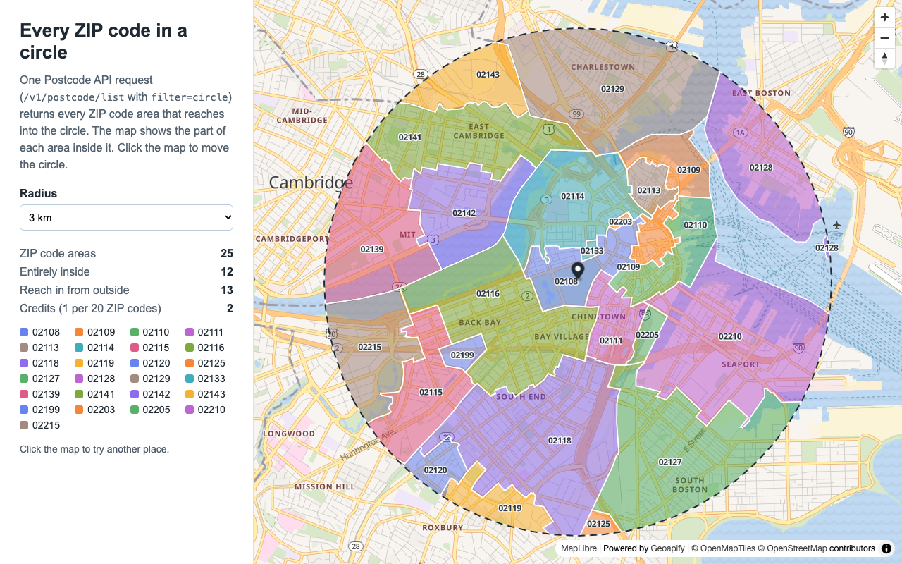

# Geoapify Postcode API Code Examples

Use Geoapify Postcode API examples to list the postcodes and ZIP codes in an area and draw their shapes on a map.

## Overview

This folder contains browser-based JavaScript examples for the Postcode API. Each example includes source code, a screenshot, and a focused README with setup notes and code samples.

## API Resources

## Live Demo

Each CodePen demo is linked from the `Live Demo` column in the code examples table.

## Code Examples

| Screenshot | Example | Description | Source Code | Live Demo |
|------------|---------|-------------|-------------|-----------|
|  | Draw Every ZIP Code in a Circle on a Map | Click the map to draw a circle and color every ZIP code area that reaches into it, cut to the circle. | [Open example](https://github.com/geoapify/geoapify-quickstart-examples/tree/main/postcode-api/draw-zip-codes-in-a-circle-on-a-map/) | [CodePen](https://codepen.io/editor/geoapify/pen/01a21844-f310-7285-b496-ce236fe852b0) |

## Geoapify API Key

These examples include demo Geoapify API keys for quick testing. For your own project, create a free API key at [myprojects.geoapify.com](https://myprojects.geoapify.com/) and replace the example key in the relevant `src/script.js` file.

## APIs and Libraries

| Name | Description | Documentation | Used In This Example |
|------|-------------|---------------|----------------------|
| Geoapify Postcode API | Finds postcodes by code or coordinates and lists the postcodes in an area, with their shapes where available. | [Postcode API docs](https://apidocs.geoapify.com/docs/postcode/) | [Draw Every ZIP Code in a Circle on a Map](./draw-zip-codes-in-a-circle-on-a-map/) |
| Geoapify Map Tiles API | Provides map styles and tiles for MapLibre-based examples. | [Map Tiles docs](https://apidocs.geoapify.com/docs/maps/map-tiles/) | [Draw Every ZIP Code in a Circle on a Map](./draw-zip-codes-in-a-circle-on-a-map/) |
| MapLibre GL JS | Renders interactive vector maps in browser examples. | [MapLibre GL JS docs](https://maplibre.org/maplibre-gl-js/docs/) | [Draw Every ZIP Code in a Circle on a Map](./draw-zip-codes-in-a-circle-on-a-map/) |
| Turf.js | Builds the circle polygon and cuts areas to it. | [Turf.js docs](https://turfjs.org/docs/) | [Draw Every ZIP Code in a Circle on a Map](./draw-zip-codes-in-a-circle-on-a-map/) |

## Useful Links

- Geoapify API documentation: [https://apidocs.geoapify.com/](https://apidocs.geoapify.com/)
- Geoapify projects and API keys: [https://myprojects.geoapify.com/](https://myprojects.geoapify.com/)
- Geoapify CodePen examples: [https://codepen.io/geoapify](https://codepen.io/geoapify)
