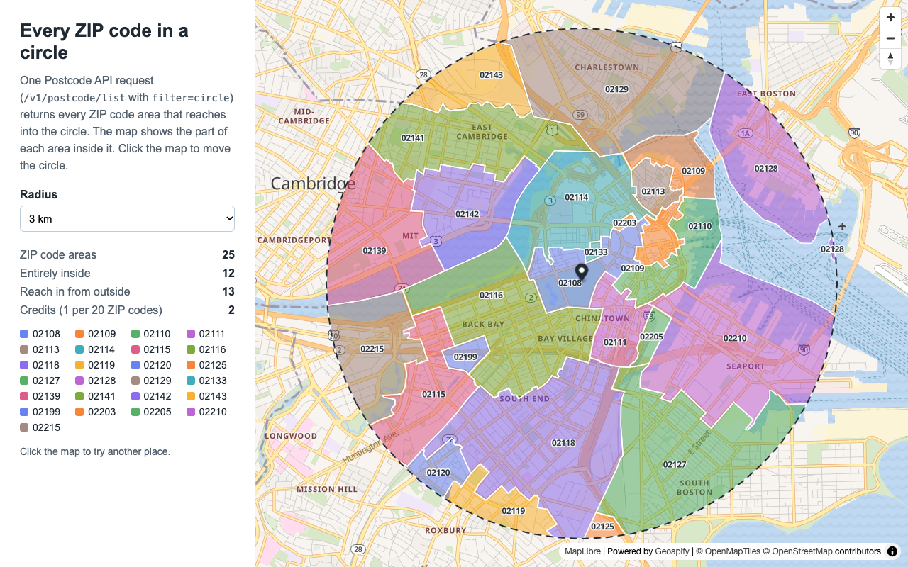

# Draw Every ZIP Code in a Circle on a Map

List all ZIP codes in a radius with one Geoapify Postcode API request (`/v1/postcode/list` with `filter=circle`) and draw every ZIP code area as a colored polygon, cut to the circle, on a MapLibre map.

## Overview

How many ZIP codes are within 3 km of a point? This example draws the circle, asks the Postcode API for every ZIP code area that reaches into it, and fills each area with its own color and label. Click the map to move the circle, or pick a radius of 1, 2, 3 or 5 km.

It opens on Boston Common, Massachusetts, with a 3 km radius: 25 ZIP code areas. 12 of them lie entirely inside the circle; 13 reach in from outside, so the sample cuts each area to the circle with Turf before drawing it. The panel shows the counts, the credits the request cost (1 credit per 20 ZIP codes), and the list of codes.

| Radius around Boston Common | ZIP code areas | Credits |
|-----------------------------|----------------|---------|
| 1 km | 11 | 1 |
| 2 km | 19 | 1 |
| 3 km | 25 | 2 |
| 5 km | 37 | 2 |

## Live Demo

[](https://codepen.io/editor/geoapify/pen/01a21844-f310-7285-b496-ce236fe852b0)

## Screenshot



## Quick Start

Open [`src/index.html`](./src/index.html) in your browser.

No build step is required.

## Geoapify API Key

This example includes a demo Geoapify API key. For your own project, create a free API key at [myprojects.geoapify.com](https://myprojects.geoapify.com/) and replace the `apiKey` value in [`src/script.js`](./src/script.js).

## Project Structure

| File | Purpose |
|------|---------|
| `src/index.html` | Page layout, radius selector, stats and ZIP code list |
| `src/script.js` | Map setup, the Postcode API request, cutting the areas to the circle, map layers and stats |
| `src/style.css` | Panel, stats and list styles |

## Key Code Samples

### List the ZIP Codes in a Circle

One request returns every ZIP code area that reaches into the circle. `geometry=original` returns the area itself instead of a single point.

```js
async function getZipCodes(lon, lat, radius) {
  const params = new URLSearchParams({
    filter: `circle:${lon},${lat},${radius}`, // radius in meters
    countrycode: "us",
    geometry: "original", // the ZIP code area, not only its point
    limit: 100,
    apiKey: "YOUR_API_KEY",
  });
  const response = await fetch(`https://api.geoapify.com/v1/postcode/list?${params}`);
  return response.json(); // GeoJSON FeatureCollection
}
```

How it works:

- `filter=circle:lon,lat,radius` takes the radius in meters. `filter=rect:` and `filter=place:` work the same way for a rectangle or a city boundary.
- The response is a GeoJSON FeatureCollection. Each feature has the ZIP code in `properties.postcode` and its area as a `Polygon` or `MultiPolygon`.
- `limit` defaults to 5, so set it. The maximum is 500; use `offset` to page through longer lists.
- The cost is 1 credit per 20 postcodes in the response: 25 ZIP codes cost 2 credits.

### Cut Each ZIP Code Area to the Circle

The list includes ZIP code areas that only touch the circle, and a rural one can cover hundreds of square kilometers. Turf cuts each area to the circle, and comparing the areas shows whether it lies entirely inside.

```js
const circle = turf.circle([lon, lat], radius / 1000, { units: "kilometers", steps: 128 });

const clipped = zipCodes.features.map((feature, i) => {
  const inside = turf.intersect(turf.featureCollection([feature, circle]));
  return {
    type: "Feature",
    geometry: (inside || feature).geometry,
    properties: {
      postcode: feature.properties.postcode,
      color: COLORS[i % COLORS.length],
      entirelyInside: inside ? turf.area(inside) / turf.area(feature) > 0.999 : false,
    },
  };
});
```

How it works:

- `turf.circle` builds the circle as a polygon in kilometers, so the same shape is drawn on the map and used for cutting.
- `turf.intersect` returns the part of the ZIP code area inside the circle.
- The color is stored in each feature, so one MapLibre layer can draw all areas.

### Draw and Label the Areas

A fill layer colors each area from its `color` property, and a symbol layer writes the ZIP code inside it.

```js
map.addLayer({
  id: "zip-areas-fill",
  type: "fill",
  source: "zip-areas",
  paint: { "fill-color": ["get", "color"], "fill-opacity": 0.45 },
});
map.addLayer({
  id: "zip-labels",
  type: "symbol",
  source: "zip-areas",
  layout: { "text-field": ["get", "postcode"], "text-font": ["Noto Sans Bold"], "text-size": 12 },
  paint: { "text-color": "#1f2933", "text-halo-color": "#ffffff", "text-halo-width": 1.5 },
});

map.getSource("zip-areas").setData(turf.featureCollection(clipped));
```

How it works:

- MapLibre places each polygon's label inside the polygon. A `MultiPolygon` area gets a label in each part.
- `Noto Sans Bold` is one of the fonts in the Geoapify OSM Bright style.
- On a map click, the sample ignores a response that arrives after a newer click or radius change.

## APIs and Libraries

| Name | Description | Documentation | Used In This Example |
|------|-------------|---------------|----------------------|
| [Geoapify Postcode API](https://www.geoapify.com/postcode-api/) | Finds postcodes by code or coordinates and lists the postcodes in an area, with their shapes where available. | [Postcode API docs](https://apidocs.geoapify.com/docs/postcode/) | ZIP code areas in the circle |
| [Geoapify Map Tiles API](https://www.geoapify.com/map-tiles/) | Provides the OSM Bright map style for MapLibre. | [Map Tiles docs](https://apidocs.geoapify.com/docs/maps/map-tiles/) | Base map |
| [MapLibre GL JS](https://maplibre.org/) | Renders the interactive vector map. | [MapLibre GL JS docs](https://maplibre.org/maplibre-gl-js/docs/) | Area, circle and label layers, marker |
| [Turf.js](https://turfjs.org/) | Geospatial analysis in the browser. | [Turf.js docs](https://turfjs.org/docs/) | Circle polygon, cutting areas to the circle, area comparison |

## Related Code Samples

| Code Sample | Why It Is Related |
|-------------|-------------------|
| [Radius Circle vs Drive-Distance Area](https://github.com/geoapify/geoapify-quickstart-examples/tree/main/isoline-api/radius-circle-vs-drive-distance-area) | The same click-to-move circle, compared with the area reachable by road |
| [ZIP Code Autofill](https://github.com/geoapify/geoapify-quickstart-examples/tree/main/geocoder-autocomplete/zip-code-autofill-city-and-state-from-zip) | Type a ZIP code and fill in the city and state |
| [City, Postcode, Street, Address By Coordinates](https://github.com/geoapify/geoapify-quickstart-examples/tree/main/geocoding-api/how-to-get-city-postcode-street-address-by-coordinates) | Get the postcode of a clicked point with reverse geocoding |

## Useful Links

- Geoapify API documentation: [https://apidocs.geoapify.com/](https://apidocs.geoapify.com/)
- Geoapify pricing and credits: [https://www.geoapify.com/pricing/](https://www.geoapify.com/pricing/)
- Geoapify CodePen examples: [https://codepen.io/geoapify](https://codepen.io/geoapify)

## License

MIT
